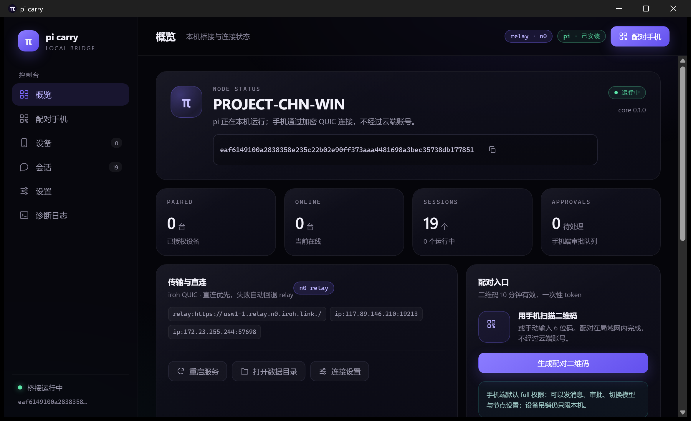
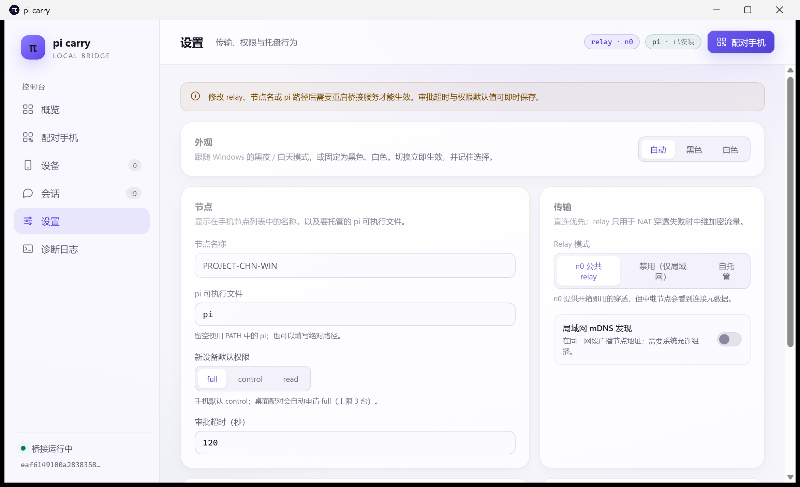
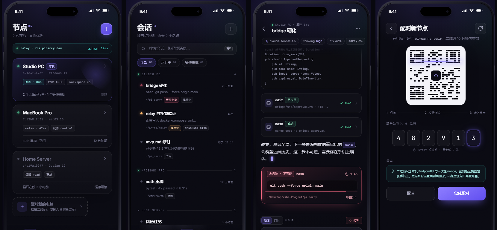

<p align="center">
  
</p>

<h1 align="center">Pi Carry</h1>

<p align="center">
  <a href="README.md">English</a> ·
  <a href="README.zh-CN.md">简体中文</a> ·
  <a href="README.ja.md">日本語</a> ·
  <a href="README.ko.md">한국어</a> ·
  <a href="README.ru.md">Русский</a>
</p>

<p align="center"><strong>パソコン上の pi を、スマートフォンから操作できるコーディングエージェントに。セッション、承認、モデル設定はデバイス間だけで流れ、クラウドアカウントは不要です。</strong></p>

<p align="center">
  
  
  
  
</p>

<p align="center">
  <a href="LICENSE"></a>
  
  
  
  
</p>

## 画面

### デスクトップ側ブリッジ

| ダークの概要 | ライトの設定 |
| :---: | :---: |
|  |  |

デスクトップアプリは常駐トレイのブリッジです。ローカルの pi プロセス、ペアリング、デバイス、診断を管理します。概要ではノード状態、認証済みデバイス、セッション数、保留中の承認、relay モード、LAN アドレスを確認できます。設定ではノード名、pi のパス、新規デバイスの既定権限、relay モード、承認タイムアウト、テーマを変更できます。**デスクトップ側にはチャットも承認 UI も意図的にありません**。制御される側で承認を迂回できないようにするためです。

### Android コントローラー



Android アプリが主な操作画面です。ノード画面では複数のパソコンを管理し、直通/relay の状態を表示します。セッションはノードごとにまとまり、検索と状態フィルタができます。チャット画面ではストリーミング本文、思考、ツール呼び出し、承認カード、Markdown、画像を表示し、送信、割り込み、キュー、中断、画像添付に対応します。ペアリングは QR コード、`pi-carry://` リンクの貼り付け、Endpoint ID と 6 桁コードの手入力で行えます。

## Pi Carry について

Pi Carry は pi コーディングエージェントのリモート操作レイヤーです。pi はパソコン上で動き続け、既存のセッションファイルを使い続けます。Pi Carry はスマートフォンとパソコンの間に暗号化された経路を作り、スマートフォンを第二の画面にします。ストリーミング返信、思考、ツール実行の確認、指示の送信、割り込み、キュー、中断、危険操作の承認、モデルと思考レベルの切り替えができます。

セッションを複製せず、クラウドアカウントも不要です。ブリッジはトレイアプリまたは CLI として動作し、pi の RPC モードでローカルセッションと連携します。スマートフォンは複数のノードを保存でき、LAN では直通、NAT 越えが必要な場合は n0 relay または自前 relay にフォールバックします。ツール呼び出しは pi 拡張でインターセプトされ、ブリッジが仲裁します。承認はタイムアウトで拒否されます。席を外している間の長時間タスクを追うためのものであり、コード、セッション、認証情報を第三者サービスに渡すためのものではありません。

現在のリリース：`0.1.3`。正式に検証している対象は **Windows 10/11 x64 と Android 8.0+** です。Linux と macOS はソースビルドの経路だけを残しており、トレイ、自動起動、単一インスタンス、配布パッケージは未検証です。設計文書にだけ存在し未実装の機能は [`docs/implementation-status.md`](docs/implementation-status.md) にまとめています。

## インストール

### 要件

| プラットフォーム | 要件 |
| --- | --- |
| Windows | Windows 10/11 x64、Microsoft Edge WebView2 Runtime、4GB 以上のメモリ推奨、検証済み |
| Linux | glibc 2.31+、WebKitGTK 4.1、libayatana-appindicator3、librsvg2、ソースビルドのみ、未検証 |
| macOS | macOS 12+、Intel または Apple Silicon、ソースビルドのみ、未検証、公証済みパッケージなし |
| Android | Android 8.0（API 26）以上、arm64-v8a または x86_64、約 100MB の空き容量 |
| 実行環境 | 設定済みの pi 1.5.2 以上。pi のインストールには Node.js 20+ が必要 |
| ネットワーク | LAN 直通はオフラインでも可。クロスネットワーク/4G は n0 relay または自前 relay が必要 |

Pi Carry は pi、Node.js、モデルの認証情報を同梱しません。ターミナルで `pi --version` が実行でき、pi のモデル設定が済んでいることを確認してください。

### デスクトップ

Releases から Windows 用ポータブル zip をダウンロードし、任意のフォルダに展開します。`pi-carry-desktop.exe` と `WebView2Loader.dll` は同じフォルダに置いたまま exe を起動してください。既定ではウィンドウを閉じるとトレイに格納されます。初回起動時に `~/.pi-carry/config.toml`、`~/.pi-carry/secrets.json`、ローカル状態データベースが作成されます。

WebView2 Runtime がない場合は、Microsoft の Evergreen Runtime をインストールしてください。Linux と macOS は現時点ではソースからビルドします（「ビルド」参照）。

### Android

Releases から ABI に合う APK をダウンロードします。一般的なスマートフォンは `arm64-v8a`、x86_64 エミュレーターは `x86_64` です。ブラウザやファイルマネージャーからのインストールを許可するよう求められる場合があります。

### 初回ペアリング

デスクトップで「スマートフォンをペアリング」を開き、QR コードを生成するか `pi-carry://pair?...` リンクをコピーします。スマートフォンでは「ノード」→「新しいパソコンをペアリング」を開き、スキャンするかリンクを貼り付けます。Endpoint ID と 6 桁コードを手入力することもできます。QR コードとコードの有効期限は 10 分で、コードを 5 回間違えると一時的にロックされます。

ペアリング後、パソコンがノード一覧に表示されます。新しいデバイスは既定で `full` 権限になります。デスクトップ設定の「新しいデバイスの既定権限」で、今後追加するデバイスを `control` または `read` に変更できます。既存デバイスの権限はその場では変更できません。取り消して再ペアリングしてください。デスクトップからいつでもデバイスを取り消せます。取り消したデバイスの次のリクエストは拒否され、再ペアリングが必要です。

## データと権限

Pi Carry はアカウント体系を持たず、テレメトリーも送信せず、セッションデータ用の独自サーバーも運用していません。データはスマートフォン、制御されるパソコン、利用者が選んだ relay の間だけを流れます。

### ローカルデータ

| 場所 | 内容 | 説明 |
| --- | --- | --- |
| `~/.pi/agent/sessions/**/*.jsonl` | pi のセッション履歴 | 唯一の正本。Pi Carry は attach し、既存履歴を複製・書き換えしない |
| `~/.pi-carry/config.toml` | ノード、転送、承認、UI 設定 | 平文。手動編集可能 |
| `~/.pi-carry/secrets.json` | iroh エンドポイント秘密鍵、任意のパスワードハッシュ | Unix では 0600。Windows はユーザープロファイルの ACL を継承。失うと再ペアリングが必要 |
| `~/.pi-carry/state.db` | デバイス、journal、承認、監査 | ローカル SQLite |
| `~/.pi-carry/logs/` | 診断ログ | プロンプト本文、ペアリング token、秘密鍵は記録しない |
| Android SharedPreferences | ノード一覧、テーマ、ローカル設定 | アプリ専用領域。アンインストールで削除 |
| Android アプリキャッシュ | 送信待ち画像の圧縮結果 | 利用者が選択した画像のみ |

スマートフォンはセッションの第二の長期保存先ではありません。メッセージとツールイベントは接続中に受信し、再接続時はブリッジの journal またはスナップショットで補完します。長期保存は pi 自身の `.jsonl` です。

### Android 権限

| 権限 | 用途 | 扱い |
| --- | --- | --- |
| `INTERNET`、`ACCESS_NETWORK_STATE` | iroh QUIC 接続、ネットワーク変化の検出 | ペアリング済みノードとの通信のみ |
| `CHANGE_NETWORK_STATE` | ネットワーク切り替え後に iroh を再バインド | 利用者のネットワーク設定は変更しない |
| `CAMERA` | ペアリング QR コードの読み取り | 実行時許可。画像はローカル処理のみで保存・送信しない |
| `POST_NOTIFICATIONS` | 承認・完了通知 | Android 13+ で実行時許可。拒否可能 |
| `FOREGROUND_SERVICE`、`FOREGROUND_SERVICE_CONNECTED_DEVICE` | 長時間接続の維持 | 常駐通知あり。利用者が停止可能 |
| `RECEIVE_BOOT_COMPLETED` | 起動後に接続用フォアグラウンドサービスを開始 | システム設定で無効化可能。この版はノード接続を自動復元しない |
| `WAKE_LOCK` | ネットワーク切り替え/短時間処理用の予約 | 宣言のみで、この版では保持しない |
| `REQUEST_IGNORE_BATTERY_OPTIMIZATIONS` | 利用者操作で電池最適化設定を開く | システム画面を開くだけ。無断申請しない |

連絡先、SMS、位置情報、マイク、全ストレージへのアクセスは要求しません。画像はシステムのフォトピッカーで選択し、選んだ画像だけを読み取り、長辺 1568 / JPEG q85 に圧縮してペアリング済みブリッジへ送ります。

### デスクトップの権限

デスクトップアプリは現在のユーザーで動作し、管理者権限は不要です。pi のセッションファイル、`~/.pi-carry` の設定・鍵・データベース・ログを読み書きし、ローカルの `pi --mode rpc` 子プロセスを起動します。自動起動を有効にすると現在のユーザーのレジストリ Run キーに 1 件書き込み、無効にすると削除します。カメラ、マイク、画面内容、キーボード入力にはアクセスしません。

### データの削除

Android アプリをアンインストールするとアプリ専用データが削除されます。デバイスを取り消すと、ブリッジはそのデバイスを拒否します。`~/.pi-carry` を削除するとペアリング、デバイス、ローカル journal がリセットされますが、pi のセッション履歴は削除されません。pi のセッションは pi の方法で管理・バックアップしてください。

## 既知の制限

- **プラットフォーム**：Windows はビルドとトレイ検証済み。Android はビルド、署名、JVM テスト済みだが実機未検証。Linux/macOS は未検証。
- **Android バックグラウンド**：起動ブロードキャストはフォアグラウンドサービスを開始するだけで、ノード接続を復元しません。メーカー独自の省電力設定で長時間接続が切れる場合があります。
- **セッション競合**：1 つのブリッジ内での単一ライターのみ保証します。外部の pi が同じセッションを書いていることは検出せず、自動で読み取り専用にもなりません。
- **検出**：mDNS は未実装。ペアリング QR コードに LAN 直通アドレスが含まれます。
- **オフライン送信**：ローカル outbox がないため、未接続時の送信は失敗します。
- **画像**：プロトコルは 5 枚までですが、Android の選択は 1 枚ずつです。画像は base64 インラインで、blob 転送はありません。
- **承認**：読み取り専用の bash も既定で確認します。「このコマンドを記憶」は現在 critical を除外しないため、危険なコマンドは毎回承認してください。
- **未実装の UI**：承認延長、セッション fork/rename/entries、汎用拡張 UI、デバイス権限変更、デスクトップのデバイス名変更、診断バンドル。
- **配布**：Tauri インストーラー、自動更新、コード署名/公証、Android instrumented tests はありません。

完全な一覧と理由は [`docs/implementation-status.md`](docs/implementation-status.md) を参照してください。

## 免責事項

Pi Carry は独立したオープンソースプロジェクトです。pi、iroh、Tauri の公式プロジェクトではなく、これらの維護者による承認や提携もありません。名称と商標はそれぞれの所有者に帰属します。

本プロジェクトは、実際のコマンド実行、ファイル変更、ネットワークアクセスを行う AI コーディングエージェントを操作します。**AI の出力は常に正しいとは限らず、誤り、古い情報、偏り、危険な提案を含む可能性があります。** **モデルが生成したコマンドやコードを盲目的に実行しないでください。** 承認前に内容を確認してください。

承認機構は注意喚起と遮断のレイヤーであり、**セキュリティサンドボックスではありません**。承認後でも、コマンドはファイル削除、未コミット変更の上書き、`git push --force`、依存関係のインストール、機密ファイルの読み取り、課金を引き起こす可能性があります。**本ツールの使用により、データ損失、コード破損、認証情報の漏洩、サービス停止、その他の取り返しのつかない結果が生じる可能性があります。** **必ずバックアップを取得し**、信頼できるリポジトリとネットワークで使用し、コマンド、作業ディレクトリ、影響範囲を確認してください。

公開 relay を使用する場合、relay 運営者は接続時刻、IP アドレス、通信量などのメタデータを確認できる可能性があります。メッセージ内容は iroh によりエンドツーエンドで暗号化されます。より厳密なプライバシーが必要な場合は、LAN 直通または自前 relay を使用してください。スマートフォンを紛失した場合や他者に操作されている場合は、直ちに制御側でデバイスを取り消してください。

本ソフトウェアは **GNU Affero General Public License v3.0** の下で「現状のまま」提供され、明示・黙示の保証はありません。**作者および貢献者は、本ソフトウェアの使用によって生じた直接的・間接的な損失、データ損失、法的・コンプライアンス上の問題について責任を負いません。** 現地法、組織のセキュリティポリシー、第三者サービスの利用規約を守って使用してください。

## ビルド

### 共通要件

Rust 1.91 以上、Cargo、Git。Windows では Visual Studio Build Tools を推奨しますが、リポジトリ設定の GNU ツールチェーンも使用できます。プロジェクトは `x86_64-pc-windows-gnu` で検証しています。Linux では WebKitGTK 4.1、libayatana-appindicator3、librsvg2 と一般的なビルドツールが必要です。macOS では Xcode Command Line Tools が必要です。

```bash
cargo build --release -p pi-carry-cli -p pi-carry-desktop
```

Windows ビルド後、`WebView2Loader.dll` が `target/release` に生成されます。配布時は `pi-carry-desktop.exe` と同じフォルダに置いてください。CLI のみなら `-p pi-carry-cli` だけでビルドできます。

Linux の Tauri 依存関係：

```bash
sudo apt install build-essential curl wget file libssl-dev \
  libwebkit2gtk-4.1-dev libayatana-appindicator3-dev librsvg2-dev
```

### Android

JDK 21、Android SDK Platform 36、Build Tools 36.0.0、Gradle 8.11.1 が必要です。`ANDROID_HOME` を設定するか、`android/local.properties` に SDK パスを書きます。リポジトリには Gradle Wrapper が含まれます。

```bash
cd android
./gradlew testDebugUnitTest assembleDebug
```

デバッグ APK は `android/app/build/outputs/apk/debug/` に出力されます。リリース配布物は必ず署名し、デバッグ APK を正式版として配布しないでください。署名設定と鍵はリリース担当者がローカルで管理し、リポジトリにはコミットしません。

リリースビルドには Android keystore と `android/keystore.properties`（Git 管理外）が必要です。

```properties
storeFile=keystore/release.jks
storePassword=***
keyAlias=pi-carry
keyPassword=***
```

`./gradlew assembleRelease` を実行すると `android/app/build/outputs/apk/release/` に出力されます。keystore がない場合は unsigned APK しか得られず、`scripts/package.ps1` はパッケージ化を拒否します。

### テスト

```bash
cargo fmt --all -- --check
cargo test -p pi-carry-protocol -p pi-carry-core
./target/debug/pi-carry smoke
./target/debug/pi-carry-desktop --smoke

cd android
./gradlew testDebugUnitTest lintDebug
```

`pi-carry smoke` は内蔵 fake-pi でプロトコル、セッション、承認、ストリーミングイベントを検証します。`--smoke` は実際のブリッジを起動し、ノード情報を出力して終了します。完全な手動受け入れでは、実際の pi、実機スマートフォン、システムトレイも確認してください。

### パッケージング

Windows ポータブルパッケージを再生成します。

```powershell
pwsh scripts/package.ps1
```

スクリプトはデスクトップ exe、`WebView2Loader.dll`、短い README、署名済み Android APK を集め、SHA256 チェックサムを生成します。署名済み APK がない場合は失敗し、デバッグ APK で代用しません。PowerShell 7 が必要です。Windows PowerShell 5.1 では `Get-FileHash` が保証されません。

### vendor ディレクトリについて

`vendor/iroh` と `vendor/iroh-relay` は Windows GNU のリンク環境向けパッチ副本です。上流の `cdylib` ターゲットが「エクスポートシンボル過多」を引き起こすため、`crate-type` を `lib` に狭めています。ルート `Cargo.toml` の `[patch.crates-io]` がこれらのディレクトリを指します。iroh を更新する際はパッチを更新するか、上流で修正済みか確認してください。

## プロジェクト構成

```text
Pi-Carry/
├── android/                     Android コントローラー
│   ├── app/src/main/java/dev/picarry/app/
│   │   ├── data/                モデル、ノード保存、リポジトリ、画像圧縮
│   │   ├── net/                 iroh 接続、フレーム、フォアグラウンドサービス、起動レシーバー
│   │   └── ui/                  テーマ、共通コンポーネント、画面
│   ├── gradle/wrapper/          Gradle Wrapper
│   ├── gradlew
│   └── settings.gradle.kts
├── assets/                      Logo と README スクリーンショット
├── crates/
│   ├── protocol/                carry.v1 フレーム、JSONL、イベント、payload、エラーコード
│   ├── core/                    設定、SQLite、ペアリング、承認、pi RPC、セッション、iroh サーバー
│   ├── cli/                     serve/status/pair/devices/revoke/doctor/smoke
│   ├── desktop/                 Tauri 2 トレイアプリ
│   ├── fake-pi/                 テスト用の決定的 pi RPC シミュレーター
│   └── e2e-client/              ブラックボックスプローブと E2E クライアント
├── desktop-ui/                  静的デスクトップコンソール
├── extensions/guard.ts          pi ツール呼び出し承認拡張
├── packaging/                   デスクトップ配布説明
├── scripts/                     環境、ビルド、パッケージ、アイコン
├── vendor/                      iroh / iroh-relay パッチ副本
├── .cargo/config.toml           Windows GNU リンカー設定
├── Cargo.toml                   Rust workspace
├── LICENSE
└── README.md
```

## 依存関係

| 区分 | 主な依存関係 |
| --- | --- |
| 実行環境 | pi 1.5.2+、Windows WebView2 Runtime、任意の n0 または自前 iroh relay |
| デスクトップ/コア | Rust 1.91+、iroh 1.3、tokio、rusqlite（bundled SQLite）、serde、argon2、qrcode、if-addrs、ulid |
| デスクトップシェル | Tauri 2、システム WebView、静的 HTML/CSS/JS |
| Android | Kotlin 2.4.10、Jetpack Compose（BOM 2025.02.00）、Material 3、iroh4k 0.2.0、kotlinx.serialization、ZXing、ExifInterface |
| Android テスト | JUnit 4、Robolectric、AndroidX Test |
| ビルド | Cargo、JDK 21、Android SDK 36、Gradle 8.11.1、PowerShell 7（パッケージ） |

サードパーティ依存関係はそれぞれのライセンスに従います。バイナリを配布する際は、pi、iroh、Tauri、iroh4k などのライセンスと帰属表示を守ってください。

## コントリビューション

バグ報告や提案は GitHub Issues へお願いします。[cyfor@foxmail.com](mailto:cyfor@foxmail.com) へのメール、または[作者のホームページ](https://www.cyfor.cn/%e5%85%b3%e4%ba%8ecyfor/)も利用できます。

## ライセンス

Pi Carry は [GNU Affero General Public License v3.0](LICENSE) で公開されています。改変してネットワークサービスとして提供する場合は、AGPL に従って対応するソースを提供してください。
