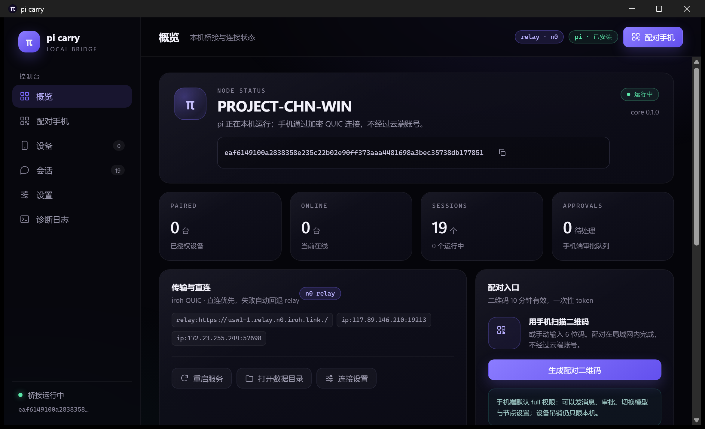
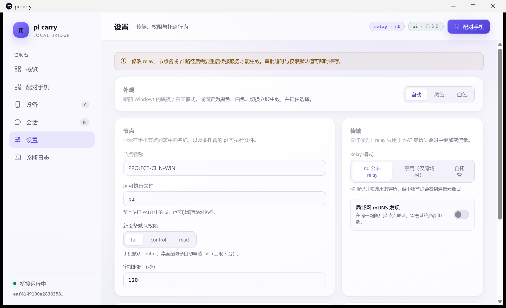
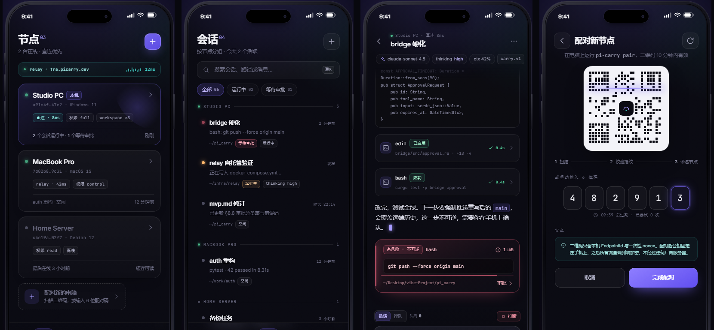

<p align="center">
  
</p>

<h1 align="center">Pi Carry</h1>

<p align="center">
  <a href="README.md">English</a> ·
  <a href="README.zh-CN.md">简体中文</a> ·
  <a href="README.ja.md">日本語</a> ·
  <a href="README.ko.md">한국어</a> ·
  <a href="README.ru.md">Русский</a>
</p>

<p align="center"><strong>PC에서 실행 중인 pi를 휴대폰에서 조작하는 코딩 에이전트로. 세션, 승인, 모델 설정은 기기 사이에서만 오가며 클라우드 계정은 필요 없습니다.</strong></p>

<p align="center">
  
  
  
  
</p>

<p align="center">
  <a href="LICENSE"></a>
  
  
  
  
</p>

## 화면

### 데스크톱 브리지

| 다크 개요 | 라이트 설정 |
| :---: | :---: |
|  |  |

데스크톱 앱은 상주 트레이 브리지입니다. 로컬 pi 프로세스, 페어링, 기기, 진단을 관리합니다. 개요에서는 노드 상태, 승인된 기기, 세션 수, 대기 중인 승인, relay 모드, LAN 주소를 볼 수 있습니다. 설정에서는 노드 이름, pi 경로, 새 기기의 기본 권한, relay 모드, 승인 시간 제한, 테마를 변경합니다. **데스크톱에는 의도적으로 채팅과 승인 UI가 없습니다.** 제어 대상 기기에서 승인을 우회할 수 없게 하기 위해서입니다.

### Android 컨트롤러



Android 앱이 주 조작 화면입니다. 노드 화면에서 여러 PC를 관리하고 직결/relay 상태를 확인합니다. 세션은 노드별로 묶이며 검색과 상태 필터를 지원합니다. 채팅 화면은 스트리밍 본문, 사고 과정, 도구 호출, 승인 카드, Markdown, 이미지를 보여 주고 전송, 개입, 대기열, 중단, 이미지 첨부를 지원합니다. 페어링은 QR 코드, `pi-carry://` 링크 붙여넣기, Endpoint ID와 6자리 코드 직접 입력으로 할 수 있습니다.

## Pi Carry 소개

Pi Carry는 pi 코딩 에이전트를 위한 원격 조작 계층입니다. pi는 PC에서 계속 실행되며 기존 세션 파일을 그대로 사용합니다. Pi Carry는 휴대폰과 PC 사이에 암호화된 경로를 만들고 휴대폰을 두 번째 화면으로 만듭니다. 스트리밍 응답, 사고 과정, 도구 실행 확인, 지시 전송, 개입, 대기열, 중단, 위험 작업 승인, 모델과 사고 수준 전환을 할 수 있습니다.

세션을 복제하지 않고 클라우드 계정도 필요 없습니다. 브리지는 트레이 앱 또는 CLI로 동작하며 pi의 RPC 모드로 로컬 세션과 연결합니다. 휴대폰은 여러 노드를 저장할 수 있고 LAN에서는 직결, NAT 통과가 필요하면 n0 relay 또는 자체 relay로 폴백합니다. 도구 호출은 pi 확장에서 가로채고 브리지가 중재합니다. 승인은 시간 초과 시 거부됩니다. 자리를 비운 동안 긴 작업을 따라가기 위한 도구이며, 코드·세션·자격 증명을 제3자 서비스에 넘기기 위한 도구가 아닙니다.

현재 릴리스: `0.1.3`. 공식 검증 대상은 **Windows 10/11 x64와 Android 8.0+**입니다. Linux와 macOS는 소스 빌드 경로만 남아 있으며 트레이, 자동 시작, 단일 인스턴스, 배포 패키지는 검증되지 않았습니다. 설계 문서에만 있고 구현되지 않은 기능은 [`docs/implementation-status.md`](docs/implementation-status.md)에 정리되어 있습니다.

## 설치

### 요구 사항

| 플랫폼 | 요구 사항 |
| --- | --- |
| Windows | Windows 10/11 x64, Microsoft Edge WebView2 Runtime, 4GB 이상 메모리 권장, 검증됨 |
| Linux | glibc 2.31+, WebKitGTK 4.1, libayatana-appindicator3, librsvg2, 소스 빌드만, 미검증 |
| macOS | macOS 12+, Intel 또는 Apple Silicon, 소스 빌드만, 미검증, 공증된 패키지 없음 |
| Android | Android 8.0(API 26) 이상, arm64-v8a 또는 x86_64, 약 100MB 여유 공간 |
| 실행 환경 | 설정된 pi 1.5.2 이상. pi 설치에는 Node.js 20+ 필요 |
| 네트워크 | LAN 직결은 오프라인에서도 가능. 교차 네트워크/4G는 n0 relay 또는 자체 relay 필요 |

Pi Carry는 pi, Node.js, 모델 자격 증명을 포함하지 않습니다. 터미널에서 `pi --version`이 실행되고 pi 모델 설정이 완료되었는지 확인하세요.

### 데스크톱

Releases에서 Windows 포터블 zip을 받아 원하는 폴더에 풉니다. `pi-carry-desktop.exe`와 `WebView2Loader.dll`은 같은 폴더에 둔 채 exe를 실행하세요. 기본적으로 창을 닫으면 트레이로 숨겨집니다. 첫 실행 시 `~/.pi-carry/config.toml`, `~/.pi-carry/secrets.json`, 로컬 상태 데이터베이스가 생성됩니다.

WebView2 Runtime이 없으면 Microsoft Evergreen Runtime을 설치하세요. Linux와 macOS는 현재 소스에서 빌드합니다("빌드" 참조).

### Android

Releases에서 ABI에 맞는 APK를 받습니다. 일반 휴대폰은 `arm64-v8a`, x86_64 에뮬레이터는 `x86_64`입니다. 브라우저나 파일 관리자에서 설치를 허용하라는 요청이 나올 수 있습니다.

### 첫 페어링

데스크톱에서 "휴대폰 페어링"을 열고 QR 코드를 만들거나 `pi-carry://pair?...` 링크를 복사합니다. 휴대폰에서는 "노드" → "새 PC 페어링"을 열고 스캔하거나 링크를 붙여넣습니다. Endpoint ID와 6자리 코드를 직접 입력할 수도 있습니다. QR 코드와 코드는 10분 동안 유효하며 코드를 5번 틀리면 일시적으로 잠깁니다.

페어링 후 PC가 노드 목록에 나타납니다. 새 기기는 기본적으로 `full` 권한을 받습니다. 데스크톱 설정의 "새 기기 기본 권한"에서 앞으로 추가할 기기를 `control` 또는 `read`로 바꿀 수 있습니다. 기존 기기의 권한은 그 자리에서 바꿀 수 없으며, 취소 후 다시 페어링해야 합니다. 데스크톱에서 언제든 기기를 취소할 수 있고, 취소된 기기의 다음 요청은 거부되며 다시 페어링해야 합니다.

## 데이터와 권한

Pi Carry는 계정 체계, 원격 측정, 세션 데이터용 자체 서버가 없습니다. 데이터는 휴대폰, 제어 대상 PC, 사용자가 선택한 relay 사이에서만 흐릅니다.

### 로컬 데이터

| 위치 | 내용 | 설명 |
| --- | --- | --- |
| `~/.pi/agent/sessions/**/*.jsonl` | pi 세션 기록 | 유일한 원본. Pi Carry는 attach하며 기존 기록을 복제하거나 덮어쓰지 않음 |
| `~/.pi-carry/config.toml` | 노드, 전송, 승인, UI 설정 | 평문, 직접 편집 가능 |
| `~/.pi-carry/secrets.json` | iroh 엔드포인트 비밀 키, 선택적 비밀번호 해시 | Unix 0600. Windows는 사용자 프로필 ACL 상속. 분실 시 재페어링 필요 |
| `~/.pi-carry/state.db` | 기기, journal, 승인, 감사 | 로컬 SQLite |
| `~/.pi-carry/logs/` | 진단 로그 | 프롬프트 본문, 페어링 token, 비밀 키는 기록하지 않음 |
| Android SharedPreferences | 노드 목록, 테마, 로컬 설정 | 앱 전용 영역. 제거 시 삭제 |
| Android 앱 캐시 | 전송할 이미지 압축 결과 | 사용자가 선택한 이미지만 |

휴대폰은 세션의 두 번째 장기 저장소가 아닙니다. 메시지와 도구 이벤트는 연결 중 수신하고 재연결 시 브리지 journal 또는 스냅샷으로 보완합니다. 장기 보관은 pi의 `.jsonl`입니다.

### Android 권한

| 권한 | 용도 | 처리 |
| --- | --- | --- |
| `INTERNET`, `ACCESS_NETWORK_STATE` | iroh QUIC 연결, 네트워크 변화 감지 | 페어링된 노드와의 통신만 |
| `CHANGE_NETWORK_STATE` | 네트워크 전환 후 iroh 재바인딩 | 사용자의 네트워크 설정은 변경하지 않음 |
| `CAMERA` | 페어링 QR 코드 읽기 | 런타임 허용. 이미지는 로컬 처리만, 저장/전송하지 않음 |
| `POST_NOTIFICATIONS` | 승인/완료 알림 | Android 13+ 런타임 허용. 거부 가능 |
| `FOREGROUND_SERVICE`, `FOREGROUND_SERVICE_CONNECTED_DEVICE` | 장시간 연결 유지 | 상주 알림 있음. 사용자가 중지 가능 |
| `RECEIVE_BOOT_COMPLETED` | 부팅 후 연결용 포그라운드 서비스 시작 | 시스템 설정에서 비활성화 가능. 이 버전은 노드 연결을 자동 복원하지 않음 |
| `WAKE_LOCK` | 네트워크 전환/짧은 작업용 예약 | 선언만 하며 이 버전에서는 보유하지 않음 |
| `REQUEST_IGNORE_BATTERY_OPTIMIZATIONS` | 사용자 조작으로 배터리 최적화 설정 열기 | 시스템 화면만 열며 임의 신청하지 않음 |

연락처, SMS, 위치, 마이크, 전체 저장소 접근은 요청하지 않습니다. 이미지는 시스템 사진 선택기로 고르고 선택한 이미지만 읽어 긴 변 1568 / JPEG q85로 압축해 페어링된 브리지로 보냅니다.

### 데스크톱 권한

데스크톱 앱은 현재 사용자로 실행되며 관리자 권한이 필요 없습니다. pi 세션 파일, `~/.pi-carry` 설정·키·데이터베이스·로그를 읽고 쓰며 로컬 `pi --mode rpc` 자식 프로세스를 시작합니다. 자동 시작을 켜면 현재 사용자 레지스트리 Run 키에 한 항목을 쓰고 끄면 삭제합니다. 카메라, 마이크, 화면 내용, 키보드 입력에는 접근하지 않습니다.

### 데이터 삭제

Android 앱을 제거하면 앱 전용 데이터가 삭제됩니다. 기기를 취소하면 브리지가 해당 기기를 거부합니다. `~/.pi-carry`를 삭제하면 페어링, 기기, 로컬 journal이 초기화되지만 pi 세션 기록은 삭제되지 않습니다. pi 세션은 pi의 방식으로 관리·백업하세요.

## 알려진 제한

- **플랫폼**: Windows는 빌드와 트레이 검증 완료. Android는 빌드, 서명, JVM 테스트 완료지만 실기기 미검증. Linux/macOS 미검증.
- **Android 백그라운드**: 부팅 브로드캐스트는 포그라운드 서비스만 시작하고 노드 연결을 복원하지 않습니다. 제조사 절전 설정 때문에 장시간 연결이 끊길 수 있습니다.
- **세션 충돌**: 한 브리지 안의 단일 작성자만 보장합니다. 외부 pi가 같은 세션을 쓰는지 감지하지 않고 자동 읽기 전용으로 전환하지 않습니다.
- **검색**: mDNS 미구현. 페어링 QR 코드에 LAN 직결 주소가 포함됩니다.
- **오프라인 전송**: 로컬 outbox가 없어 미연결 시 전송이 실패합니다.
- **이미지**: 프로토콜은 5장까지지만 Android 선택은 한 번에 1장입니다. 이미지는 base64 인라인이며 blob 전송은 없습니다.
- **승인**: 읽기 전용 bash도 기본으로 확인합니다. "이 명령 기억"은 현재 critical을 제외하지 않으므로 위험한 명령은 매번 승인하세요.
- **미구현 UI**: 승인 연장, 세션 fork/rename/entries, 범용 확장 UI, 기기 권한 변경, 데스크톱 기기 이름 변경, 진단 번들.
- **배포**: Tauri 설치 프로그램, 자동 업데이트, 코드 서명/공증, Android instrumented tests 없음.

전체 목록과 이유는 [`docs/implementation-status.md`](docs/implementation-status.md)를 참조하세요.

## 면책 조항

Pi Carry는 독립 오픈 소스 프로젝트입니다. pi, iroh, Tauri의 공식 프로젝트가 아니며 해당 유지 관리자의 승인이나 제휴도 없습니다. 이름과 상표는 각 소유자에게 귀속됩니다.

이 프로젝트는 실제 명령 실행, 파일 변경, 네트워크 접근을 수행하는 AI 코딩 에이전트를 조작합니다. **AI 출력은 항상 정확하지 않으며 오류, 오래된 정보, 편향, 위험한 제안을 포함할 수 있습니다.** **모델이 생성한 명령이나 코드를 무작정 실행하지 마세요.** 승인 전에 내용을 확인하세요.

승인 메커니즘은 주의 환기와 차단 계층이며 **보안 샌드박스가 아닙니다**. 승인 후에도 명령은 파일 삭제, 커밋되지 않은 변경 덮어쓰기, `git push --force`, 의존성 설치, 민감 파일 읽기, 과금을 일으킬 수 있습니다. **이 도구 사용으로 데이터 손실, 코드 손상, 자격 증명 유출, 서비스 중단, 기타 되돌릴 수 없는 결과가 발생할 수 있습니다.** **반드시 백업을 만들고** 신뢰할 수 있는 저장소와 네트워크에서 사용하며 명령, 작업 디렉터리, 영향을 확인하세요.

공용 relay를 사용하면 relay 운영자가 연결 시간, IP 주소, 트래픽 양 등 메타데이터를 볼 수 있습니다. 메시지 내용은 iroh로 종단 간 암호화됩니다. 더 엄격한 프라이버시가 필요하면 LAN 직결 또는 자체 relay를 사용하세요. 휴대폰을 잃어버렸거나 타인이 조작 중이면 즉시 제어 대상 기기에서 기기를 취소하세요.

이 소프트웨어는 **GNU Affero General Public License v3.0**에 따라 "있는 그대로" 제공되며 명시적·묵시적 보증이 없습니다. **작성자와 기여자는 이 소프트웨어 사용으로 인한 직접적·간접적 손실, 데이터 손실, 법적·규정 준수 문제에 책임지지 않습니다.** 현지 법률, 조직 보안 정책, 제3자 서비스 약관을 준수하세요.

## 빌드

### 공통 요구 사항

Rust 1.91+, Cargo, Git. Windows에서는 Visual Studio Build Tools를 권장하지만 저장소 설정의 GNU 툴체인도 사용할 수 있습니다. 프로젝트는 `x86_64-pc-windows-gnu`에서 검증했습니다. Linux는 WebKitGTK 4.1, libayatana-appindicator3, librsvg2와 일반 빌드 도구가 필요합니다. macOS는 Xcode Command Line Tools가 필요합니다.

```bash
cargo build --release -p pi-carry-cli -p pi-carry-desktop
```

Windows 빌드 후 `WebView2Loader.dll`이 `target/release`에 생성됩니다. 배포 시 `pi-carry-desktop.exe`와 같은 폴더에 두세요. CLI만 필요하면 `-p pi-carry-cli`만 빌드하면 됩니다.

Linux Tauri 의존성:

```bash
sudo apt install build-essential curl wget file libssl-dev \
  libwebkit2gtk-4.1-dev libayatana-appindicator3-dev librsvg2-dev
```

### Android

JDK 21, Android SDK Platform 36, Build Tools 36.0.0, Gradle 8.11.1이 필요합니다. `ANDROID_HOME`을 설정하거나 `android/local.properties`에 SDK 경로를 씁니다. 저장소에 Gradle Wrapper가 포함되어 있습니다.

```bash
cd android
./gradlew testDebugUnitTest assembleDebug
```

디버그 APK는 `android/app/build/outputs/apk/debug/`에 출력됩니다. 릴리스 배포물은 반드시 서명하고 디버그 APK를 정식 버전으로 배포하지 마세요. 서명 설정과 키는 릴리스 담당자가 로컬에서 관리하며 저장소에 커밋하지 않습니다.

릴리스 빌드에는 Android keystore와 `android/keystore.properties`(Git 관리 외)가 필요합니다.

```properties
storeFile=keystore/release.jks
storePassword=***
keyAlias=pi-carry
keyPassword=***
```

`./gradlew assembleRelease`를 실행하면 `android/app/build/outputs/apk/release/`에 출력됩니다. keystore가 없으면 unsigned APK만 나오며 `scripts/package.ps1`은 패키징을 거부합니다.

### 테스트

```bash
cargo fmt --all -- --check
cargo test -p pi-carry-protocol -p pi-carry-core
./target/debug/pi-carry smoke
./target/debug/pi-carry-desktop --smoke

cd android
./gradlew testDebugUnitTest lintDebug
```

`pi-carry smoke`는 내장 fake-pi로 프로토콜, 세션, 승인, 스트리밍 이벤트를 검증합니다. `--smoke`는 실제 브리지를 시작해 노드 정보를 출력하고 종료합니다. 전체 수동 승인은 실제 pi, 실기기 휴대폰, 시스템 트레이까지 확인하세요.

### 패키징

Windows 포터블 패키지를 다시 만듭니다.

```powershell
pwsh scripts/package.ps1
```

스크립트는 데스크톱 exe, `WebView2Loader.dll`, 짧은 README, 서명된 Android APK를 모아 SHA256 체크섬을 만듭니다. 서명된 APK가 없으면 실패하며 디버그 APK로 대체하지 않습니다. PowerShell 7이 필요합니다. Windows PowerShell 5.1에서는 `Get-FileHash`가 보장되지 않습니다.

### vendor 디렉터리

`vendor/iroh`와 `vendor/iroh-relay`는 Windows GNU 링크 환경용 패치 사본입니다. 업스트림 `cdylib` 타깃이 "내보내기 심볼 과다"를 일으켜 `crate-type`을 `lib`로 좁혔습니다. 루트 `Cargo.toml`의 `[patch.crates-io]`가 이 디렉터리를 가리킵니다. iroh를 업데이트할 때 패치를 갱신하거나 업스트림에서 수정되었는지 확인하세요.

## 프로젝트 구조

```text
Pi-Carry/
├── android/                     Android 컨트롤러
│   ├── app/src/main/java/dev/picarry/app/
│   │   ├── data/                모델, 노드 저장, 리포지토리, 이미지 압축
│   │   ├── net/                 iroh 연결, 프레임, 포그라운드 서비스, 부팅 리시버
│   │   └── ui/                  테마, 공용 컴포넌트, 화면
│   ├── gradle/wrapper/          Gradle Wrapper
│   ├── gradlew
│   └── settings.gradle.kts
├── assets/                      로고와 README 스크린샷
├── crates/
│   ├── protocol/                carry.v1 프레임, JSONL, 이벤트, payload, 오류 코드
│   ├── core/                    설정, SQLite, 페어링, 승인, pi RPC, 세션, iroh 서버
│   ├── cli/                     serve/status/pair/devices/revoke/doctor/smoke
│   ├── desktop/                 Tauri 2 트레이 앱
│   ├── fake-pi/                 테스트용 결정적 pi RPC 시뮬레이터
│   └── e2e-client/              블랙박스 프로브와 E2E 클라이언트
├── desktop-ui/                  정적 데스크톱 콘솔
├── extensions/guard.ts          pi 도구 호출 승인 확장
├── packaging/                   데스크톱 배포 설명
├── scripts/                     환경, 빌드, 패키징, 아이콘
├── vendor/                      iroh / iroh-relay 패치 사본
├── .cargo/config.toml           Windows GNU 링커 설정
├── Cargo.toml                   Rust workspace
├── LICENSE
└── README.md
```

## 의존성

| 구분 | 주요 의존성 |
| --- | --- |
| 실행 환경 | pi 1.5.2+, Windows WebView2 Runtime, 선택적 n0 또는 자체 iroh relay |
| 데스크톱/코어 | Rust 1.91+, iroh 1.3, tokio, rusqlite(bundled SQLite), serde, argon2, qrcode, if-addrs, ulid |
| 데스크톱 셸 | Tauri 2, 시스템 WebView, 정적 HTML/CSS/JS |
| Android | Kotlin 2.4.10, Jetpack Compose(BOM 2025.02.00), Material 3, iroh4k 0.2.0, kotlinx.serialization, ZXing, ExifInterface |
| Android 테스트 | JUnit 4, Robolectric, AndroidX Test |
| 빌드 | Cargo, JDK 21, Android SDK 36, Gradle 8.11.1, PowerShell 7(패키징) |

서드파티 의존성은 각자의 라이선스를 따릅니다. 바이너리를 배포할 때 pi, iroh, Tauri, iroh4k 등의 라이선스와 저작자 표시를 지키세요.

## 기여

버그 보고와 제안은 GitHub Issues를 이용하세요. [cyfor@foxmail.com](mailto:cyfor@foxmail.com)으로 메일을 보내거나 [작성자 홈페이지](https://www.cyfor.cn/%e5%85%b3%e4%ba%8ecyfor/)를 방문할 수도 있습니다.

## 라이선스

Pi Carry는 [GNU Affero General Public License v3.0](LICENSE)으로 공개됩니다. 수정하여 네트워크 서비스로 제공하는 경우 AGPL에 따라 대응 소스를 제공해야 합니다.
