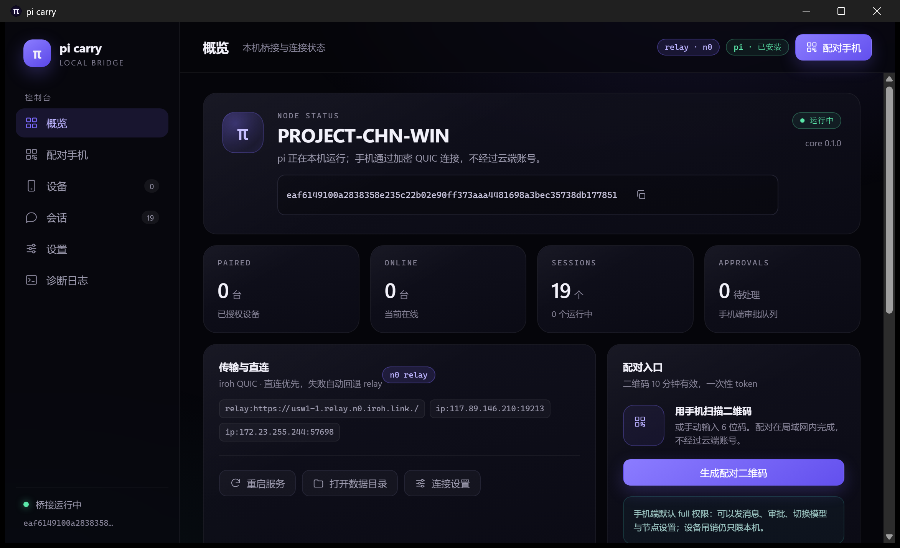
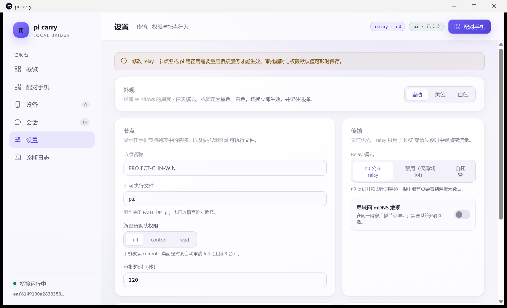
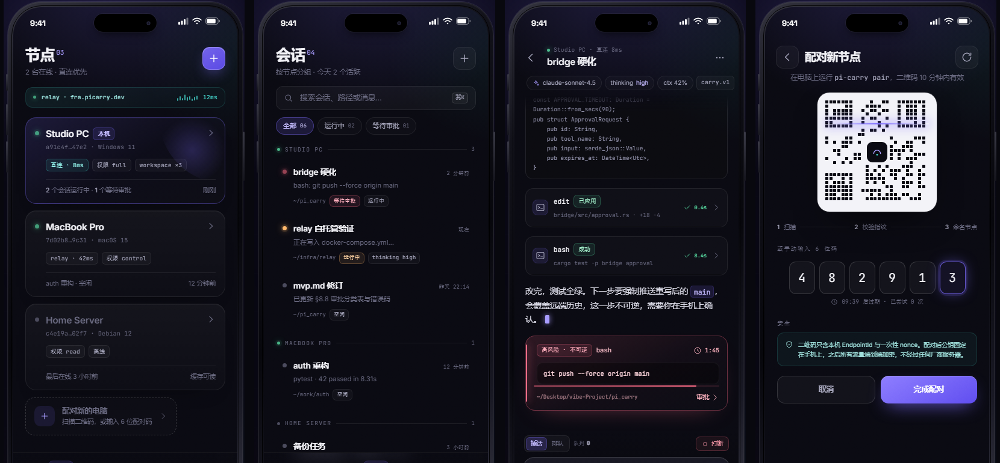

<p align="center">
  
</p>

<h1 align="center">Pi Carry</h1>

<p align="center">
  <a href="README.md">English</a> ·
  <a href="README.zh-CN.md">简体中文</a> ·
  <a href="README.ja.md">日本語</a> ·
  <a href="README.ko.md">한국어</a> ·
  <a href="README.ru.md">Русский</a>
</p>

<p align="center"><strong>Turn pi on your computer into a coding agent you can drive from your phone. Sessions, approvals, and model settings stay on your devices — not in a cloud account.</strong></p>

<p align="center">
  
  
  
  
</p>

<p align="center">
  <a href="LICENSE"></a>
  
  
  
  
</p>

## Interface

### Desktop bridge

| Dark overview | Light settings |
| :---: | :---: |
|  |  |

The desktop app is a tray-resident bridge. It owns the local pi processes, pairing, devices, and diagnostics. The overview shows node status, authorized devices, session counts, pending approvals, relay mode, and LAN addresses. Settings let you change the node name, pi path, default capability for new devices, relay mode, approval timeout, and theme. **The desktop app deliberately has no chat or approval UI**, so approvals cannot be bypassed on the controlled machine.

### Android controller



The Android app is the primary controller. The nodes screen manages multiple computers and shows direct/relay status. Sessions are grouped by node and can be searched and filtered. The chat screen renders streaming text, thinking, tool calls, approval cards, Markdown, and images; it supports send, steer, queue, abort, and image attachments. Pairing works by QR code, pasted `pi-carry://` link, or manual endpoint ID plus 6-digit code.

## About Pi Carry

Pi Carry is a remote control layer for the pi coding agent. pi keeps running on your computer and keeps using its existing session files. Pi Carry opens an encrypted channel between the phone and the computer, turning the phone into a second screen: watch streaming replies, thinking, and tool execution; send instructions; steer, queue, or abort; approve risky operations; switch models and thinking levels.

It does not copy sessions and does not require a cloud account. The bridge runs as a tray app or CLI and talks to pi over its RPC mode. The phone can store multiple nodes, connect directly on the LAN, and fall back to the n0 relay or a self-hosted relay when NAT traversal is required. Tool calls are intercepted by a pi extension and arbitrated by the bridge; approvals time out to deny. It is built for following long-running work while away from the desk — not for handing code, sessions, or credentials to a third-party service.

Current release: `0.3.0`. Windows 10/11 x64 is the primary verified target. macOS 11+ Universal and Linux x64/arm64 packages are built by the release pipeline but have not completed full real-machine acceptance. The macOS build is **unsigned and not notarized**; see [Installing unsigned builds](#installing-unsigned-builds).

## Installation

### Requirements

| Platform | Requirement |
| --- | --- |
| Windows | Windows 10 21H2+ or Windows 11, x64; Microsoft Edge WebView2 Runtime; 4 GB RAM recommended |
| macOS | macOS 11+; Intel or Apple Silicon (Universal build); unsigned, not notarized |
| Linux | Ubuntu 22.04+ (x64) or Ubuntu 24.04+ (arm64 — the arm64 package is built on 24.04), Debian 12+, Fedora 39+, or RHEL 9+; x64 or arm64; WebKitGTK 4.1, GTK 3, libayatana-appindicator3 |
| Android | Android 8.0 (API 26)+; arm64-v8a or x86_64; about 100 MiB free space |
| Runtime | pi 1.5.0 or newer, already configured (validated with 1.5.2); installing pi requires Node.js 20+ |
| Network | LAN direct connection works offline; cross-network or 4G needs the n0 relay or a self-hosted relay |

Pi Carry does not bundle pi, Node.js, or model credentials. Make sure `pi --version` works in a terminal and pi is already configured with a model. On macOS and Linux, launch Pi Carry once from the desktop so it can discover pi from your login shell environment.

### Download

Release assets use a fixed naming scheme. For version `0.3.0`:

| Asset | Purpose |
| --- | --- |
| `pi-carry-windows-10-x64-0.3.0-setup.exe` | Windows installer (NSIS, current user, no administrator rights) |
| `pi-carry-windows-10-x64-0.3.0.zip` | Windows portable build |
| `pi-carry-macos-11-universal-0.3.0.dmg` | macOS Universal disk image |
| `pi-carry-macos-11-universal-0.3.0.app.tar.gz` (+ `.sig`) | Updater artifact; not needed for manual installation |
| `pi-carry-linux-22.04-x64-0.3.0.deb` / `.rpm` | Linux packages for x64 |
| `pi-carry-linux-24.04-arm64-0.3.0.deb` / `.rpm` | Linux packages for arm64 (built on 24.04) |
| `latest.json` | Update manifest used by the built-in updater |
| `SHA256SUMS.txt` | Checksums for every release asset |

CI builds these assets on version tags and creates a **draft** GitHub Release. A maintainer reviews the draft and publishes it manually.

### Windows

Run `pi-carry-windows-10-x64-0.3.0-setup.exe`. The installer is per-user and does not require administrator rights. It installs the desktop app, creates Start Menu entries, and registers the `pi-carry://` deep-link scheme.

For the portable build, extract `pi-carry-windows-10-x64-0.3.0.zip` anywhere, keep `pi-carry-desktop.exe` and `WebView2Loader.dll` in the same folder, and run the exe. By default the window closes to the tray. The portable build has no uninstaller; like the installer, it registers the `pi-carry://` handler on first launch. Use the installer if you want an entry in Apps & features.

Both forms use `%USERPROFILE%\.pi-carry` for configuration, keys, state, and logs. Autostart is off by default; enabling it in Settings registers a per-user entry (`HKCU\Software\Microsoft\Windows\CurrentVersion\Run`, value `pi-carry`).

If WebView2 Runtime is missing, install the Evergreen Runtime from Microsoft and start Pi Carry again.

### macOS

Open `pi-carry-macos-11-universal-0.3.0.dmg`, drag **pi carry** into **Applications**, eject the disk image, and launch the app from Applications. The build is Universal and runs natively on Intel and Apple Silicon.

The app is unsigned and not notarized, so Gatekeeper blocks the first launch. See [Installing unsigned builds](#installing-unsigned-builds). The first start creates `~/.pi-carry/config.toml`, the local state database, and the keychain entries used for pairing secrets.

### Linux

Download the package that matches your architecture and install it with the distribution package manager. Do not use `dpkg -i` or `rpm -i` directly, because they do not resolve dependencies.

```bash
# Debian / Ubuntu, x64
sudo apt install ./pi-carry-linux-22.04-x64-0.3.0.deb

# Fedora / RHEL, x64
sudo dnf install ./pi-carry-linux-22.04-x64-0.3.0.rpm
```

Replace `x64` with `arm64` on arm64 machines. The packages declare these runtime dependencies:

- deb: `libwebkit2gtk-4.1-0`, `libgtk-3-0`, `libayatana-appindicator3-1`
- rpm: `webkit2gtk4.1`, `gtk3`, `libayatana-appindicator-gtk3`

GNOME does not show tray icons by default. Install the AppIndicator/KStatusNotifierItem extension (`gnome-shell-extension-appindicator`) if the tray icon does not appear. Pi Carry keeps running as a bridge even when the tray is unavailable, and its self-check card explains the missing tray.

### Installing unsigned builds

The project does not yet hold a Windows code-signing certificate; the SignPath Foundation application has not been submitted. The macOS build is intentionally unsigned and not notarized.

**Windows SmartScreen.** On first launch Windows may show “Windows protected your PC”. Click **More info → Run anyway**. Verify the download first:

```powershell
Get-FileHash .\pi-carry-windows-10-x64-0.3.0-setup.exe -Algorithm SHA256
# compare with the matching line in SHA256SUMS.txt
```

**macOS Gatekeeper.** After the first launch attempt, open **System Settings → Privacy & Security**, scroll to **Security**, and click **Open Anyway** for “pi carry”, then confirm. Alternatively, remove the quarantine attribute:

```bash
xattr -dr com.apple.quarantine "/Applications/pi carry.app"
```

**macOS keychain.** The app stores the pairing secret in the login keychain. macOS may ask for permission again after an update or rebuild; choose **Always Allow** if you trust the build. If keychain access is denied or unavailable, Pi Carry falls back to a plaintext secrets file and shows a warning banner in the app.

**Checksums.** Every release includes `SHA256SUMS.txt`. On macOS and Linux:

```bash
shasum -a 256 -c SHA256SUMS.txt --ignore-missing
# or: sha256sum -c SHA256SUMS.txt --ignore-missing
```

### Android

Download the APK for your ABI from Releases: `arm64-v8a` for most phones, `x86_64` for x86_64 emulators. Android may ask you to allow installation from a browser or file manager.

### First pairing

On the desktop, open “Pair phone” and generate a QR code or copy the `pi-carry://pair?...` link. On the phone, open “Nodes” → “Pair a new computer” and scan or paste the link. You can also enter the endpoint ID and 6-digit code manually. QR codes and codes are valid for 10 minutes; five wrong code attempts trigger a temporary lock.

On Windows and Linux the installer or first run registers the `pi-carry` deep-link scheme, so opening a pairing link launches or focuses Pi Carry. The link only **pre-fills** the pairing screen; it never confirms pairing by itself. Always check the endpoint fingerprint on the phone before confirming. On macOS the scheme is declared in the app bundle. `pi-carry-desktop --pair-uri <uri>` remains available for scripts and troubleshooting.

After pairing, the computer appears in the node list. New devices get `full` capability by default. “Default capability for new devices” in desktop settings can change this for future devices to `control` or `read`. An existing device cannot be changed in place; revoke it and pair again. You can revoke a device at any time from the desktop; its next request is rejected and it must pair again.

### Keeping Pi Carry updated

Settings → **Update channel** selects `stable` or `beta`. Stable follows the latest published release; beta follows the `beta` prerelease tag and may be unstable. When “Check on startup” is enabled, Pi Carry checks silently 30 seconds after launch; you can also run **Check for updates** from the tray menu or Settings.

- Updates are signed with minisign and verified before installation. A signature failure blocks the update and is reported as a signature error.
- Windows installer builds update in place. The portable build never replaces its own exe; it only tells you a new version is available and links to the download.
- macOS updater builds replace the `.app` in place. In-place update of an **unsigned** app still needs real-machine verification; if it fails, download the DMG and replace the app manually.
- Linux updates call the system package manager and require polkit authorization. If authorization is cancelled, Pi Carry shows the manual command instead of retrying.
- A failed update is classified as a signature, authorization/elevation, or installation failure, with a matching hint. Only signature failures suppress repeated prompts for that version.

To roll back:

| Platform | Command |
| --- | --- |
| Windows | Run the older `pi-carry-windows-10-x64-<version>-setup.exe` over the installed version |
| macOS | Quit the app, mount the older DMG, drag **pi carry** into Applications and replace |
| Debian / Ubuntu | `sudo apt install --allow-downgrades ./pi-carry-linux-22.04-x64-<version>.deb` |
| Fedora / RHEL | `sudo dnf downgrade pi-carry`, or `sudo dnf install ./pi-carry-linux-22.04-x64-<version>.rpm` |
| Windows portable | Exit the app, replace the extracted folder, and keep `~/.pi-carry` |

## Data handling and permissions

Pi Carry has no account system, no telemetry, and no project-operated server for session data. Data moves only between the phone, the controlled computer, and the relay you choose.

### Local data

| Location | Content | Notes |
| --- | --- | --- |
| `~/.pi/agent/sessions/**/*.jsonl` | pi session history | Source of truth; Pi Carry attaches and does not copy or rewrite existing history |
| `~/.pi-carry/config.toml` | Node, transport, approval, UI settings | Plain text, editable by hand |
| OS keyring | iroh endpoint secret, optional password hash | Windows Credential Manager, macOS Keychain, or Linux Secret Service; service name `dev.picarry.desktop` |
| `~/.pi-carry/secrets.json` | Fallback secret storage only | Used when the keyring is unavailable or denied; mode 0600 on Unix. When the keyring works, only a migration marker remains |
| `~/.pi-carry/state.db` | Devices, journal, approvals, audit records | Local SQLite database |
| `~/.pi-carry/logs/` | Diagnostic logs | Rotated daily or at 10 MB, kept for 7 days; prompt bodies, pairing tokens, and private keys are not logged |
| Android SharedPreferences | Node list, theme, local switches | App-private storage; removed on uninstall |
| Android app cache | Compressed images waiting to be sent | Only images explicitly selected by the user |

On Windows the data directory is `%USERPROFILE%\.pi-carry`. `PI_CARRY_HOME` overrides the whole data directory; `PI_CARRY_SESSIONS` overrides the session scan root. Use them to run isolated test instances or a second profile.

The phone is not a second long-term session store. Messages and tool events arrive over the live connection; after a reconnect, the bridge journal or a session snapshot fills the gap. The durable session record remains pi’s own `.jsonl` file.

### Android permissions

| Permission | Purpose | Handling |
| --- | --- | --- |
| `INTERNET`, `ACCESS_NETWORK_STATE` | iroh QUIC connection and network changes | Only used with paired nodes |
| `CHANGE_NETWORK_STATE` | Re-bind the iroh endpoint after network changes | Does not change user network settings |
| `CAMERA` | Scan pairing QR codes | Runtime permission; frames are processed locally and never stored or uploaded |
| `POST_NOTIFICATIONS` | Approval and completion alerts | Runtime permission on Android 13+; may be denied |
| `FOREGROUND_SERVICE`, `FOREGROUND_SERVICE_CONNECTED_DEVICE` | Keep the long-lived connection | Persistent notification; user can stop the service |
| `RECEIVE_BOOT_COMPLETED` | Start the connection foreground service after boot | Can be disabled in system settings; this version does not automatically restore node connections |
| `WAKE_LOCK` | Reserved for network changes/short tasks | Declared but not actively held in this version |
| `REQUEST_IGNORE_BATTERY_OPTIMIZATIONS` | Open battery optimization settings on user request | Only opens the system screen; never requested silently |

The app does not request contacts, SMS, location, microphone, or broad storage access. Images are chosen through the system photo picker, read only when selected, and compressed to long edge 1568 / JPEG q85 before being sent to a paired bridge.

### Desktop permissions

The desktop app runs as the current user and does not require administrator rights. It reads and writes pi session files, `~/.pi-carry` configuration, keys, database, and logs, and starts local `pi --mode rpc` child processes. Enabling autostart writes one per-user entry:

- Windows: `HKCU\Software\Microsoft\Windows\CurrentVersion\Run`, value `pi-carry`
- macOS: `~/Library/LaunchAgents/dev.picarry.desktop.plist`
- Linux: `~/.config/autostart/pi-carry.desktop`

Disabling autostart removes the entry. When the tray is available, the autostart command includes `--minimized`, so the app starts in the tray instead of opening a window. The desktop app does not access the camera, microphone, screen contents, or keyboard input.

### Deleting data

Uninstalling the Android app removes its private data. Revoking a device makes the bridge reject that device. Deleting `~/.pi-carry` resets pairing, devices, and the local journal but does not delete pi’s session history. Manage or back up pi sessions through pi itself.

## Known limitations

- **Platforms**: Windows 10/11 x64 is the primary verified target. macOS and Linux packages are built by the release pipeline, but full real-machine acceptance of tray, autostart, deep links, and installation is still incomplete. The macOS app is unsigned and not notarized.
- **Android background**: the boot receiver only starts the foreground service; it does not restore node connections. Some OEM battery policies may still kill long connections.
- **Session conflicts**: only one writer per session is enforced inside one bridge. An external pi process writing the same session is not detected, and the app does not switch to read-only automatically.
- **Discovery**: no mDNS. The pairing QR code carries LAN direct addresses.
- **Offline sending**: there is no local outbox; sends fail while disconnected.
- **Images**: up to 10 images per message (20 MiB each, 100 MiB per session). Android uploads originals through the chunked, content-addressed `blob.put` channel (resume/retry supported); history images are rendered from the local blob cache. Legacy clients can still inline base64.
- **Approvals**: read-only bash still asks by default; “remember this command” never auto-approves critical commands, so dangerous commands still need one-by-one approval.
- **Missing UI entry points**: generic extension UI, device capability changes, desktop device rename, diagnostics bundle.
- **Signing and delivery**: the Windows installer is not Authenticode-signed and the SignPath Foundation application has not been submitted. The macOS app is unsigned and not notarized. In-place update of the unsigned macOS build still needs real-machine verification. Android has no instrumented tests.
- **Linux tray**: GNOME requires the AppIndicator extension; without a tray implementation the tray icon is unavailable and the self-check card reports it.

## Disclaimer

Pi Carry is an independent open-source project. It is not affiliated with, endorsed by, or maintained by pi, iroh, or Tauri. Their names and trademarks belong to their respective owners.

This project drives an AI coding agent that can execute real commands, modify files, and access the network. **AI output is not guaranteed to be correct and may contain errors, outdated information, bias, or unsafe suggestions.** **Do not blindly execute model-generated commands or code.** Review what the agent proposes before approving it.

The approval system is a prompt and interception layer, **not a security sandbox**. Even after approval, a command may delete files, overwrite uncommitted changes, run `git push --force`, install dependencies, read sensitive files, or incur costs. **Using this tool may cause data loss, code corruption, credential exposure, service interruption, or other irreversible consequences.** **Keep backups**, use it in trusted repositories and networks, and verify the command, working directory, and impact before approving.

When using a public relay, the relay operator may see metadata such as connection time, IP address, and traffic volume. Message contents are end-to-end encrypted by iroh. For a stricter privacy boundary, use LAN direct connections or a self-hosted relay. If a phone is lost or controlled by someone else, revoke the device on the controlled computer immediately.

This software is provided “as is” under the **GNU Affero General Public License v3.0**, without any express or implied warranty. **The authors and contributors are not liable for any direct or indirect loss, data loss, or legal or compliance issues caused by using this software.** Use it in compliance with local law, organizational security policy, and third-party terms of service.

## Build

### General requirements

Rust 1.91 or newer, Cargo, and Git. On Windows, Visual Studio Build Tools are recommended, or use the GNU toolchain configured by the repository; the project is verified under `x86_64-pc-windows-gnu`. Linux needs WebKitGTK 4.1, libayatana-appindicator3, librsvg2, and normal build tools; macOS needs Xcode Command Line Tools.

```bash
cargo build --release -p pi-carry-cli -p pi-carry-desktop
```

After a Windows build, `WebView2Loader.dll` appears in `target/release`; it must be distributed in the same folder as `pi-carry-desktop.exe`. If you only need the CLI, build `-p pi-carry-cli`.

Linux Tauri dependencies:

```bash
sudo apt install build-essential curl wget file libssl-dev \
  libwebkit2gtk-4.1-dev libayatana-appindicator3-dev librsvg2-dev
```

### Android

JDK 21, Android SDK Platform 36, Build Tools 36.0.0, and Gradle 8.11.1 are required. Set `ANDROID_HOME` or write the SDK path to `android/local.properties`. The repository includes the Gradle Wrapper:

```bash
cd android
./gradlew testDebugUnitTest assembleDebug
```

Debug APKs are written to `android/app/build/outputs/apk/debug/`. Release packages must be signed; never distribute a debug APK as a production build. Signing configuration and keys are managed locally by the release owner and are not committed.

A release build needs an Android keystore and `android/keystore.properties` (ignored by Git):

```properties
storeFile=keystore/release.jks
storePassword=***
keyAlias=pi-carry
keyPassword=***
```

Then run `./gradlew assembleRelease`; outputs go to `android/app/build/outputs/apk/release/`. Without a keystore you only get an unsigned APK, and `scripts/package.ps1` refuses to package it.

### Tests

```bash
cargo fmt --all -- --check
cargo test --workspace
node scripts/set-version.mjs --check

bash scripts/smoke.sh
bash scripts/e2e.sh

cd android
./gradlew testDebugUnitTest lintDebug
```

`scripts/smoke.sh` builds the CLI, desktop, and fake-pi binaries, runs the Rust tests, runs `pi-carry smoke`, and starts the real desktop bridge with an isolated `PI_CARRY_HOME` before exiting. `scripts/e2e.sh` starts a bridge with fake-pi and runs the black-box end-to-end client. Both scripts work in Linux CI and in Git Bash on Windows.

`node scripts/set-version.mjs --check` verifies that the Rust workspace, desktop manifest, Android `versionName`/`versionCode`, and generated files agree. Run `node scripts/set-version.mjs <version>` to update them together.

### Packaging

Windows (installer and portable zip):

```powershell
pwsh scripts/package.ps1
```

Linux (deb and rpm for the current architecture):

```bash
bash scripts/package-linux.sh
```

macOS (Universal DMG plus updater artifact):

```bash
bash scripts/package-macos.sh
```

The scripts write versioned assets and `SHA256SUMS.txt` to `dist/`. Generate the updater manifest for a release with:

```bash
node scripts/gen-latest-json.mjs --dir dist --version 0.3.0 \
  --base-url https://github.com/y-cyfor/Pi-Carry/releases/download/v0.3.0
```

`scripts/package.ps1` packs the release-signed Android APK together with the Windows assets; it fails rather than substituting a debug APK. PowerShell 7 is recommended; Windows PowerShell 5.1 also works — the script derives SHA-256 with `System.Security.Cryptography` and does not rely on `Get-FileHash`.

The `build-android` job in `.github/workflows/release.yml` builds both ABI APKs with `assembleRelease` and needs the repository secrets `ANDROID_KEYSTORE_BASE64`, `ANDROID_KEYSTORE_PASSWORD`, `ANDROID_KEY_ALIAS` and `ANDROID_KEY_PASSWORD`; it fails instead of publishing unsigned APKs.

### About the vendor directory

`vendor/iroh` and `vendor/iroh-relay` are patched copies for the Windows GNU link environment. The upstream `cdylib` target triggers “too many exported symbols”, so their `crate-type` is narrowed to `lib`. The root `Cargo.toml` points to these directories with `[patch.crates-io]`. When upgrading iroh, update the patches or verify that upstream has fixed the issue.

## Project layout

```text
Pi-Carry/
├── android/                     Android controller
│   ├── app/src/main/java/dev/picarry/app/
│   │   ├── data/                Models, node storage, repository, image compression
│   │   ├── net/                 iroh connection, framing, foreground service, boot receiver
│   │   └── ui/                  Theme, shared components, screens
│   ├── gradle/wrapper/          Gradle Wrapper
│   ├── gradlew
│   └── settings.gradle.kts
├── assets/                      Logo and README screenshots
├── crates/
│   ├── protocol/                carry.v1 frames, JSONL, events, payloads, error codes
│   ├── core/                    Config, SQLite, pairing, approval, pi RPC, sessions, iroh server
│   ├── cli/                     serve/status/pair/devices/revoke/doctor/smoke
│   ├── desktop/                 Tauri 2 tray app
│   ├── fake-pi/                 Deterministic pi RPC simulator for tests
│   └── e2e-client/              Black-box probe and end-to-end client
├── design/desktop-ui/           Static desktop console (Tauri frontend)
├── extensions/guard.ts          pi tool-call approval extension
├── packaging/                   Desktop release notes
├── scripts/                     Environment, build, packaging, version, icon, and test scripts
├── vendor/                      Patched iroh / iroh-relay copies
├── .github/workflows/           CI and draft release workflow
├── .cargo/config.toml           Windows GNU linker configuration
├── Cargo.toml                   Rust workspace
├── LICENSE
└── README.md
```

## Dependencies

| Area | Main dependencies |
| --- | --- |
| Runtime | pi 1.5.0+ (validated with 1.5.2); Windows WebView2 Runtime; optional n0 or self-hosted iroh relay |
| Desktop and core | Rust 1.91+, iroh 1.3, tokio, rusqlite (bundled SQLite), serde, argon2, qrcode, if-addrs, ulid, keyring |
| Desktop shell | Tauri 2, system WebView, static HTML/CSS/JS, tauri-plugin-updater, tauri-plugin-deep-link |
| Android | Kotlin 2.4.10, Jetpack Compose (BOM 2025.02.00), Material 3, iroh4k 0.2.0, kotlinx.serialization, ZXing, ExifInterface |
| Android tests | JUnit 4, Robolectric, AndroidX Test |
| Build | Cargo, JDK 21, Android SDK 36, Gradle 8.11.1, PowerShell 7 (packaging) |

Third-party dependencies keep their own licenses. When distributing binaries, comply with the licenses and attribution requirements of pi, iroh, Tauri, iroh4k, and other dependencies.

## Contributing

Use GitHub Issues for bug reports and suggestions. You can also email [cyfor@foxmail.com](mailto:cyfor@foxmail.com) or visit the [author’s homepage](https://www.cyfor.cn/%e5%85%b3%e4%ba%8ecyfor/).

## License

Pi Carry is released under the [GNU Affero General Public License v3.0](LICENSE). If you modify it and provide it as a network service, you must offer the corresponding source under the AGPL.
