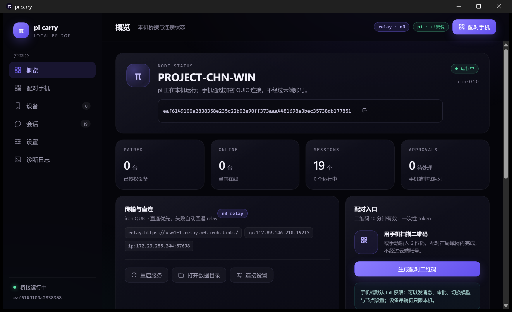
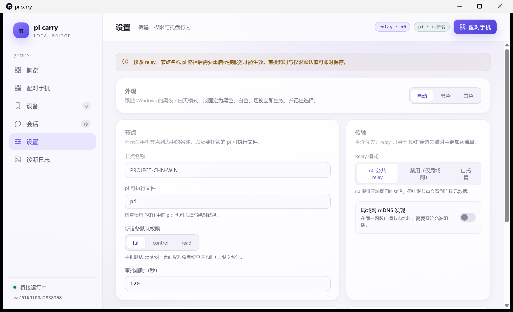
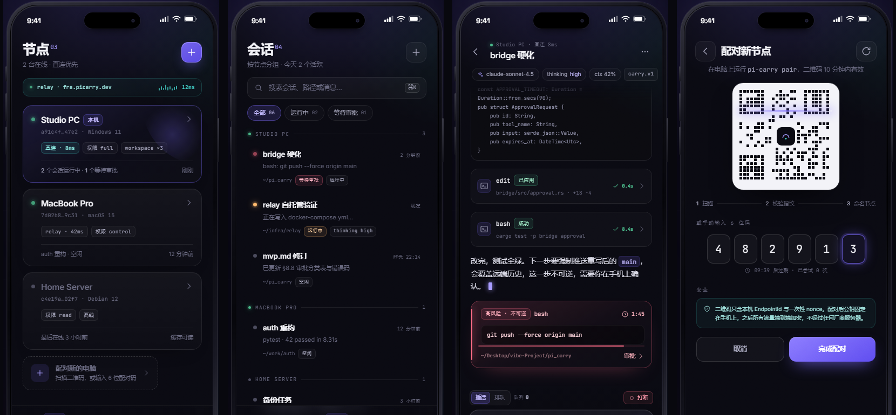

<p align="center">
  
</p>

<h1 align="center">Pi Carry</h1>

<p align="center">
  <a href="README.md">English</a> ·
  <a href="README.zh-CN.md">简体中文</a> ·
  <a href="README.ja.md">日本語</a> ·
  <a href="README.ko.md">한국어</a> ·
  <a href="README.ru.md">Русский</a>
</p>

<p align="center"><strong>Превратите pi на компьютере в coding-агента, которым можно управлять с телефона. Сессии, подтверждения и настройки моделей остаются на ваших устройствах — без облачного аккаунта.</strong></p>

<p align="center">
  
  
  
  
</p>

<p align="center">
  <a href="LICENSE"></a>
  
  
  
  
</p>

## Интерфейс

### Настольный мост

| Тёмный обзор | Светлые настройки |
| :---: | :---: |
|  |  |

Настольное приложение — это мост, постоянно работающий в системном трее. Оно отвечает за локальные процессы pi, сопряжение, устройства и диагностику. На обзорном экране видны состояние узла, авторизованные устройства, число сессий, ожидающие подтверждения, режим relay и адреса в локальной сети. В настройках можно изменить имя узла, путь к pi, права новых устройств по умолчанию, режим relay, тайм-аут подтверждения и тему. **В настольном приложении намеренно нет чата и экрана подтверждений**, чтобы подтверждения нельзя было обойти на управляемом компьютере.

### Android-контроллер



Android-приложение — основной интерфейс управления. Экран узлов позволяет работать с несколькими компьютерами и показывает прямое подключение или relay. Сессии сгруппированы по узлам, поддерживают поиск и фильтр по состоянию. В чате отображаются потоковый текст, рассуждения, вызовы инструментов, карточки подтверждений, Markdown и изображения; доступны отправка, вмешательство, очередь, прерывание и вложения. Сопряжение выполняется по QR-коду, вставленной ссылке `pi-carry://` или вручную по Endpoint ID и 6-значному коду.

## О Pi Carry

Pi Carry — уровень удалённого управления для coding-агента pi. pi продолжает работать на компьютере и использует существующие файлы сессий. Pi Carry открывает зашифрованный канал между телефоном и компьютером и превращает телефон во второй экран: можно смотреть потоковые ответы, рассуждения и выполнение инструментов, отправлять инструкции, вмешиваться, ставить в очередь или прерывать, подтверждать рискованные операции, переключать модели и уровни рассуждения.

Проект не копирует сессии и не требует облачного аккаунта. Мост работает как приложение в трее или CLI и общается с pi через режим RPC. Телефон хранит несколько узлов, подключается напрямую в локальной сети, а при необходимости обхода NAT использует relay n0 или собственный relay. Вызовы инструментов перехватываются расширением pi, а мост принимает решение; при истечении тайм-аута подтверждение отклоняется. Инструмент рассчитан на сопровождение долгих задач вдали от рабочего места, а не на передачу кода, сессий или учётных данных третьим лицам.

Текущая версия — `0.3.2`. Основная проверенная платформа — Windows 10/11 x64. Пакеты macOS 11+ Universal и Linux x64/arm64 собираются в релизном конвейере, но полная приёмка на реальных машинах ещё не завершена. Сборка macOS **не подписана и не нотаризована**; см. [Установка неподписанных сборок](#установка-неподписанных-сборок).

## Установка

### Требования

| Платформа | Требование |
| --- | --- |
| Windows | Windows 10 21H2+ или Windows 11, x64; Microsoft Edge WebView2 Runtime; рекомендуется 4 ГБ ОЗУ |
| macOS | macOS 11+; Intel или Apple Silicon (сборка Universal); без подписи и нотаризации |
| Linux | Ubuntu 22.04+ (x64), Ubuntu 24.04+ (пакет arm64 собран на 24.04), Debian 12+, Fedora 39+ или RHEL 9+; x64 или arm64; WebKitGTK 4.1, GTK 3, libayatana-appindicator3 |
| Android | Android 8.0 (API 26)+; arm64-v8a или x86_64; около 100 МиБ свободного места |
| Среда | Установленный и настроенный pi 1.5.0 или новее (проверено на 1.5.2); для установки pi нужен Node.js 20+ |
| Сеть | Прямое подключение в локальной сети работает офлайн; для разных сетей или 4G нужен relay n0 или собственный relay |

Pi Carry не включает pi, Node.js или учётные данные моделей. Убедитесь, что в терминале работает `pi --version` и pi уже настроен. В macOS и Linux запустите Pi Carry один раз с рабочего стола, чтобы приложение нашло pi в окружении командной оболочки входа.

### Загрузка

Имена релизных файлов фиксированы. Для версии `0.3.2`:

| Файл | Назначение |
| --- | --- |
| `pi-carry-windows-10-x64-0.3.2-setup.exe` | Установщик Windows (NSIS, для текущего пользователя, без прав администратора) |
| `pi-carry-windows-10-x64-0.3.2.zip` | Портативная сборка Windows |
| `pi-carry-macos-11-universal-0.3.2.dmg` | Образ macOS Universal |
| `pi-carry-macos-11-universal-0.3.2.app.tar.gz` (+ `.sig`) | Артефакт обновления; для ручной установки не нужен |
| `pi-carry-linux-22.04-x64-0.3.2.deb` / `.rpm` | Пакеты Linux x64 |
| `pi-carry-linux-24.04-arm64-0.3.2.deb` / `.rpm` | Пакеты Linux arm64 (собраны на 24.04) |
| `latest.json` | Манифест для встроенного обновления |
| `SHA256SUMS.txt` | Контрольные суммы всех файлов |

CI собирает эти файлы по тегам версий и создаёт **черновик** GitHub Release. Сопровождающий проверяет его и публикует вручную.

### Windows

Запустите `pi-carry-windows-10-x64-0.3.2-setup.exe`. Установщик ставит приложение для текущего пользователя, не требует прав администратора, создаёт пункты меню «Пуск» и регистрирует схему `pi-carry://`.

Портативную сборку распакуйте из `pi-carry-windows-10-x64-0.3.2.zip` в любую папку, оставьте `pi-carry-desktop.exe` и `WebView2Loader.dll` рядом и запустите exe. По умолчанию окно при закрытии сворачивается в трей. В портативной сборке нет деинсталлятора; при первом запуске она, как и установщик, регистрирует обработчик `pi-carry://`. Если нужен пункт удаления в «Приложения и возможности», используйте установщик.

Оба варианта хранят настройки, ключи, состояние и журналы в `%USERPROFILE%\.pi-carry`. Автозапуск по умолчанию выключен; после включения в настройках создаётся запись автозапуска текущего пользователя (`HKCU\Software\Microsoft\Windows\CurrentVersion\Run`, значение `pi-carry`).

Если WebView2 Runtime отсутствует, установите Evergreen Runtime от Microsoft и запустите Pi Carry снова.

### macOS

Откройте `pi-carry-macos-11-universal-0.3.2.dmg`, перетащите **pi carry** в **Программы**, извлеките образ и запустите приложение. Сборка Universal работает нативно на Intel и Apple Silicon.

Приложение не подписано и не нотаризовано, поэтому Gatekeeper блокирует первый запуск. См. [Установка неподписанных сборок](#установка-неподписанных-сборок). При первом запуске создаются `~/.pi-carry/config.toml`, локальная база состояния и записи связки ключей для секретов сопряжения.

### Linux

Скачайте пакет для своей архитектуры и установите его штатным менеджером пакетов. Не используйте `dpkg -i` или `rpm -i` напрямую: они не разрешают зависимости.

```bash
# Debian / Ubuntu, x64
sudo apt install ./pi-carry-linux-22.04-x64-0.3.2.deb

# Fedora / RHEL, x64
sudo dnf install ./pi-carry-linux-22.04-x64-0.3.2.rpm
```

На arm64 замените `x64` на `arm64` в имени файла. Пакеты объявляют зависимости:

- deb: `libwebkit2gtk-4.1-0`, `libgtk-3-0`, `libayatana-appindicator3-1`
- rpm: `webkit2gtk4.1`, `gtk3`, `libayatana-appindicator-gtk3`

GNOME по умолчанию не показывает значки в трее. Если значок не появился, установите расширение AppIndicator/KStatusNotifierItem (`gnome-shell-extension-appindicator`). Без трея Pi Carry продолжает работать как мост, а карточка самопроверки объясняет причину.

### Установка неподписанных сборок

У проекта пока нет сертификата подписи кода Windows, заявка в SignPath Foundation не подана. Сборка macOS намеренно не подписана и не нотаризована.

**Windows SmartScreen.** При первом запуске может появиться «Windows защитила ваш компьютер». Нажмите **Подробнее → Выполнить в любом случае**. Сначала проверьте загрузку:

```powershell
Get-FileHash .\pi-carry-windows-10-x64-0.3.2-setup.exe -Algorithm SHA256
# сравните со строкой в SHA256SUMS.txt
```

**macOS Gatekeeper.** После первой попытки запуска откройте **Системные настройки → Конфиденциальность и безопасность**, прокрутите до **Безопасность** и нажмите **Всё равно открыть** для «pi carry», затем подтвердите. Можно также снять атрибут карантина:

```bash
xattr -dr com.apple.quarantine "/Applications/pi carry.app"
```

**Связка ключей macOS.** Секрет сопряжения хранится в связке ключей входа. После обновления или пересборки macOS может снова запросить разрешение; выберите **Всегда разрешать**, если доверяете сборке. При отказе или недоступности связки ключей Pi Carry переходит на файл с секретами в открытом виде и показывает предупреждение в верхней части окна.

**Контрольные суммы.** Каждый релиз содержит `SHA256SUMS.txt`. В macOS и Linux:

```bash
shasum -a 256 -c SHA256SUMS.txt --ignore-missing
# или: sha256sum -c SHA256SUMS.txt --ignore-missing
```

### Android

Скачайте APK для своей ABI из Releases: `arm64-v8a` для большинства телефонов, `x86_64` для эмуляторов x86_64. Система может запросить разрешение на установку из браузера или файлового менеджера.

### Первое сопряжение

На компьютере откройте «Сопряжение телефона», создайте QR-код или скопируйте ссылку `pi-carry://pair?...`. На телефоне откройте «Узлы» → «Сопрячь новый компьютер» и отсканируйте код или вставьте ссылку. Можно ввести Endpoint ID и 6-значный код вручную. QR-код и код действуют 10 минут; после пяти ошибок вход временно блокируется.

В Windows и Linux установщик или первый запуск регистрирует схему `pi-carry`, поэтому ссылка сопряжения запускает или выводит Pi Carry на передний план. Ссылка только **заполняет** экран сопряжения и никогда не подтверждает его автоматически. Перед подтверждением проверьте отпечаток Endpoint на телефоне. В macOS схема объявлена в пакете приложения. `pi-carry-desktop --pair-uri <uri>` остаётся для скриптов и диагностики.

После сопряжения компьютер появляется в списке узлов. Новые устройства по умолчанию получают `full`. Настройка «Права новых устройств по умолчанию» может задать для будущих устройств `control` или `read`. Изменить права существующего устройства нельзя: отзовите его и сопрягите заново. Устройство можно отозвать в любой момент; следующий запрос будет отклонён, и потребуется повторное сопряжение.

### Обновления

В настройках **канал обновлений** выбирает `stable` или `beta`. Stable следует последнему официальному релизу, beta — тегу предварительного выпуска `beta` и может быть нестабильным. При включённой опции «Проверять при запуске» Pi Carry тихо проверяет обновления через 30 секунд после старта. Проверку можно запустить вручную из меню трея или настроек.

- Пакеты обновлений подписаны minisign и проверяются перед установкой. Ошибка подписи блокирует обновление и показывается как ошибка подписи.
- Установщик Windows обновляется на месте. Портативная сборка никогда не заменяет свой exe, а только сообщает о новой версии и даёт ссылку на загрузку.
- Обновление macOS заменяет `.app` на месте. **Обновление неподписанного приложения на месте ещё требует проверки на реальной машине**; при неудаче скачайте DMG и замените приложение вручную.
- Обновление Linux вызывает системный менеджер пакетов и требует авторизации polkit. При отмене Pi Carry показывает команду для ручной установки и не повторяет попытку.
- Неудача классифицируется как ошибка подписи, авторизации/повышения прав или установки с соответствующим пояснением. Только ошибка подписи подавляет повторные напоминания для этой версии.

Откат:

| Платформа | Действие |
| --- | --- |
| Windows, установщик | Запустить старый `pi-carry-windows-10-x64-<версия>-setup.exe` поверх установленной версии |
| Windows, портативная | Закрыть приложение, заменить папку, сохранив `~/.pi-carry` |
| macOS | Закрыть приложение, смонтировать старый DMG, перетащить **pi carry** в «Программы» и заменить |
| Debian / Ubuntu | `sudo apt install --allow-downgrades ./pi-carry-linux-22.04-x64-<версия>.deb` |
| Fedora / RHEL | `sudo dnf downgrade pi-carry` или `sudo dnf install ./pi-carry-linux-22.04-x64-<версия>.rpm` |

## Данные и разрешения

В Pi Carry нет аккаунтов, телеметрии и собственного сервера для данных сессий. Данные передаются только между телефоном, управляемым компьютером и выбранным вами relay.

### Локальные данные

| Расположение | Содержимое | Примечание |
| --- | --- | --- |
| `~/.pi/agent/sessions/**/*.jsonl` | История сессий pi | Единственный источник истины; Pi Carry подключается и не копирует и не перезаписывает историю |
| `~/.pi-carry/config.toml` | Настройки узла, транспорта, подтверждений, интерфейса | Открытый текст, можно редактировать вручную |
| Связка ключей ОС | Секрет endpoint iroh, необязательный хеш пароля | Windows Credential Manager, macOS Keychain или Linux Secret Service; имя службы `dev.picarry.desktop` |
| `~/.pi-carry/secrets.json` | Только резервное хранилище секретов | Используется при недоступности или отказе связки ключей; права 0600 в Unix. При работающей связке остаётся только маркер миграции |
| `~/.pi-carry/state.db` | Устройства, journal, подтверждения, аудит | Локальная база SQLite |
| `~/.pi-carry/logs/` | Диагностические журналы | Ротация ежедневно или при 10 МБ, хранение 7 дней; тексты промптов, токены сопряжения и закрытые ключи не записываются |
| Android SharedPreferences | Список узлов, тема, локальные переключатели | Приватное хранилище приложения; удаляется при удалении приложения |
| Кэш Android | Сжатые изображения, ожидающие отправки | Только изображения, выбранные пользователем |

В Windows каталог данных — `%USERPROFILE%\.pi-carry`. `PI_CARRY_HOME` переопределяет весь каталог данных, `PI_CARRY_SESSIONS` — корень поиска сессий. Это удобно для изолированных тестов или второго профиля.

Телефон не является вторым долговременным хранилищем сессий. Сообщения и события инструментов приходят по живому соединению; после переподключения пробел заполняется из journal моста или снимка сессии. Долговременная запись остаётся в файлах `.jsonl` самого pi.

### Разрешения Android

| Разрешение | Назначение | Обработка |
| --- | --- | --- |
| `INTERNET`, `ACCESS_NETWORK_STATE` | Соединение iroh QUIC и отслеживание сети | Только для связи с сопряжёнными узлами |
| `CHANGE_NETWORK_STATE` | Перепривязка endpoint iroh после смены сети | Не меняет сетевые настройки пользователя |
| `CAMERA` | Сканирование QR-кода сопряжения | Разрешение во время работы; кадры обрабатываются локально и не сохраняются и не отправляются |
| `POST_NOTIFICATIONS` | Уведомления о подтверждениях и завершении | Разрешение в Android 13+; можно отклонить |
| `FOREGROUND_SERVICE`, `FOREGROUND_SERVICE_CONNECTED_DEVICE` | Поддержание длительного соединения | Постоянное уведомление; службу можно остановить |
| `RECEIVE_BOOT_COMPLETED` | Запуск foreground-службы соединения после загрузки | Можно отключить в настройках системы; текущая версия не восстанавливает соединения с узлами автоматически |
| `WAKE_LOCK` | Резерв для смены сети и коротких задач | Объявлено, но активно не удерживается в этой версии |
| `REQUEST_IGNORE_BATTERY_OPTIMIZATIONS` | Открыть настройки оптимизации батареи по запросу | Только открывает системный экран, не запрашивается скрытно |

Приложение не запрашивает контакты, SMS, геолокацию, микрофон и доступ ко всему хранилищу. Изображения выбираются через системный выбор фото, читаются только выбранные и сжимаются до длинной стороны 1568 / JPEG q85 перед отправкой сопряжённому мосту.

### Разрешения настольного приложения

Настольное приложение работает от текущего пользователя и не требует прав администратора. Оно читает и записывает файлы сессий pi, настройки, ключи, базу и журналы в `~/.pi-carry`, а также запускает локальные дочерние процессы `pi --mode rpc`. При включении автозапуска создаётся одна запись текущего пользователя:

- Windows: `HKCU\Software\Microsoft\Windows\CurrentVersion\Run`, значение `pi-carry`
- macOS: `~/Library/LaunchAgents/dev.picarry.desktop.plist`
- Linux: `~/.config/autostart/pi-carry.desktop`

Отключение автозапуска удаляет запись. Если трей доступен, команда автозапуска включает `--minimized`, чтобы приложение стартовало в трее без окна. Настольное приложение не обращается к камере, микрофону, содержимому экрана или вводу с клавиатуры.

### Удаление данных

Удаление Android-приложения стирает его приватные данные. Отзыв устройства заставляет мост отклонять его запросы. Удаление `~/.pi-carry` сбрасывает сопряжение, устройства и локальный journal, но не удаляет историю сессий pi. Управляйте сессиями pi и создавайте их резервные копии средствами самого pi.

## Известные ограничения

- **Платформы**: основная проверенная платформа — Windows 10/11 x64. Пакеты macOS и Linux собираются в релизном конвейере, но полная приёмка трея, автозапуска, ссылок, установки и удаления на реальных машинах ещё не завершена. Приложение macOS не подписано и не нотаризовано.
- **Фон Android**: приёмник загрузки только запускает foreground-службу и не восстанавливает соединения с узлами. Политики энергосбережения некоторых производителей могут завершать длительные соединения.
- **Конфликты сессий**: в одном мосте гарантируется только один писатель. Внешний процесс pi, пишущий ту же сессию, не обнаруживается, и автоматический переход в режим только чтения не выполняется.
- **Обнаружение**: mDNS не реализован. QR-код сопряжения содержит адреса прямого подключения в локальной сети.
- **Отправка офлайн**: локального outbox нет, при отсутствии соединения отправка завершается ошибкой.
- **Изображения**: до 10 на сообщение (20 МиБ каждое, 100 МиБ на сессию). Используется контентно-адресуемый канал blob (фрагменты по 512 КиБ, SHA-256, докачка); изображения истории берутся из локального кэша blob. Старые клиенты могут встраивать base64.
- **Подтверждения**: bash только для чтения по умолчанию тоже спрашивает; «запомнить команду» не одобряет critical-команды автоматически, опасные команды требуют подтверждения каждый раз.
- **Нет экранов**: общий UI расширений, изменение прав устройства, переименование настольного устройства, диагностический пакет.
- **Подпись и поставка**: установщик Windows не подписан Authenticode, заявка в SignPath Foundation не подана. macOS не подписан и не нотаризован, обновление неподписанной сборки на месте требует проверки на реальной машине. В Android нет instrumented-тестов.
- **Трей Linux**: в GNOME нужно расширение AppIndicator; без реализации трея значок недоступен, и карточка самопроверки сообщает об этом.

## Отказ от ответственности

Pi Carry — независимый open-source проект. Он не является официальным проектом pi, iroh или Tauri и не связан с их сопровождающими и не одобрен ими. Названия и товарные знаки принадлежат их владельцам.

Проект управляет AI coding-агентом, который выполняет реальные команды, изменяет файлы и обращается к сети. **Вывод AI не гарантированно верен и может содержать ошибки, устаревшие сведения, предвзятость или небезопасные рекомендации.** **Не выполняйте команды и код, сгенерированные моделью, без проверки.** Просматривайте предложения агента перед подтверждением.

Механизм подтверждений — слой предупреждения и перехвата, **а не песочница безопасности**. Даже после подтверждения команда может удалить файлы, перезаписать незакоммиченные изменения, выполнить `git push --force`, установить зависимости, прочитать конфиденциальные файлы или привести к расходам. **Использование инструмента может вызвать потерю данных, повреждение кода, утечку учётных данных, простой или иные необратимые последствия.** **Делайте резервные копии**, работайте в доверенных репозиториях и сетях, проверяйте команду, рабочий каталог и последствия.

При использовании публичного relay оператор может видеть метаданные: время подключения, IP-адрес и объём трафика. Содержимое сообщений шифруется iroh end-to-end. Для более строгой приватности используйте прямое подключение в локальной сети или собственный relay. Если телефон потерян или им управляет кто-то другой, немедленно отзовите устройство на управляемом компьютере.

Программное обеспечение предоставляется «как есть» по **GNU Affero General Public License v3.0**, без явных или подразумеваемых гарантий. **Авторы и участники не несут ответственности за прямые или косвенные потери, потерю данных, юридические или регуляторные проблемы, вызванные использованием программы.** Соблюдайте местные законы, политику безопасности организации и условия третьих сторон.

## Сборка

### Общие требования

Нужны Rust 1.91 или новее, Cargo и Git. В Windows рекомендуются Visual Studio Build Tools или настроенный в репозитории GNU-тулчейн; проект проверен в `x86_64-pc-windows-gnu`. В Linux нужны WebKitGTK 4.1, libayatana-appindicator3, librsvg2 и обычные инструменты сборки; в macOS — Xcode Command Line Tools.

```bash
cargo build --release -p pi-carry-cli -p pi-carry-desktop
```

После сборки в Windows в `target/release` появляется `WebView2Loader.dll`; при распространении он должен лежать рядом с `pi-carry-desktop.exe`. Если нужен только CLI, собирайте `-p pi-carry-cli`.

Зависимости Tauri для Linux:

```bash
sudo apt install build-essential curl wget file libssl-dev \
  libwebkit2gtk-4.1-dev libayatana-appindicator3-dev librsvg2-dev
```

### Android

Нужны JDK 21, Android SDK Platform 36, Build Tools 36.0.0 и Gradle 8.11.1. Задайте `ANDROID_HOME` или укажите путь к SDK в `android/local.properties`. В репозитории есть Gradle Wrapper:

```bash
cd android
./gradlew testDebugUnitTest assembleDebug
```

Отладочные APK находятся в `android/app/build/outputs/apk/debug/`. Релизные пакеты должны быть подписаны; никогда не распространяйте debug APK как официальную сборку. Параметры подписи и ключи хранятся у владельца релиза локально и не коммитятся.

Для релизной сборки нужны Android keystore и `android/keystore.properties` (исключён из Git):

```properties
storeFile=keystore/release.jks
storePassword=***
keyAlias=pi-carry
keyPassword=***
```

Затем выполните `./gradlew assembleRelease`; результат появится в `android/app/build/outputs/apk/release/`. Без keystore получится только неподписанный APK, и `scripts/package.ps1` откажется собирать пакет.

### Тесты

```bash
cargo fmt --all -- --check
cargo test --workspace
node scripts/set-version.mjs --check

bash scripts/smoke.sh
bash scripts/e2e.sh

cd android
./gradlew testDebugUnitTest lintDebug
```

`scripts/smoke.sh` собирает CLI, настольное приложение и fake-pi, запускает тесты Rust, `pi-carry smoke` и настоящий мост с изолированным `PI_CARRY_HOME`. `scripts/e2e.sh` запускает мост с fake-pi и чёрноящичный end-to-end клиент. Оба скрипта работают в Linux CI и в Git Bash в Windows.

`node scripts/set-version.mjs --check` проверяет согласованность версий в Rust workspace, манифесте настольного приложения, Android `versionName`/`versionCode` и сгенерированных файлах. Команда `node scripts/set-version.mjs <version>` обновляет их вместе.

### Упаковка

Windows (установщик и портативный zip):

```powershell
pwsh scripts/package.ps1
```

Linux (deb и rpm для текущей архитектуры):

```bash
bash scripts/package-linux.sh
```

macOS (Universal DMG и артефакт обновления):

```bash
bash scripts/package-macos.sh
```

Скрипты записывают файлы с версией и `SHA256SUMS.txt` в `dist/`. Манифест обновления для релиза:

```bash
node scripts/gen-latest-json.mjs --dir dist --version 0.3.2 \
  --base-url https://github.com/y-cyfor/Pi-Carry/releases/download/v0.3.2
```

`scripts/package.ps1` вместе с Windows-сборками упаковывает официально подписанный Android APK; без подписанного APK он завершается ошибкой, а не подставляет debug-сборку. Рекомендуется PowerShell 7, но Windows PowerShell 5.1 тоже работает: SHA-256 считается через `System.Security.Cryptography`, без `Get-FileHash`.

Job `build-android` в `.github/workflows/release.yml` собирает APK для обеих ABI через `assembleRelease` и требует secrets репозитория `ANDROID_KEYSTORE_BASE64`, `ANDROID_KEYSTORE_PASSWORD`, `ANDROID_KEY_ALIAS`, `ANDROID_KEY_PASSWORD`; без них он падает и не публикует неподписанные APK.

### О каталоге vendor

`vendor/iroh` и `vendor/iroh-relay` — пропатченные копии для среды компоновки Windows GNU. Цель `cdylib` в upstream вызывает ошибку «слишком много экспортируемых символов», поэтому `crate-type` сужен до `lib`. Корневой `Cargo.toml` указывает на эти каталоги через `[patch.crates-io]`. При обновлении iroh обновите патчи или проверьте, исправлено ли это в upstream.

## Структура проекта

```text
Pi-Carry/
├── android/                     Android-контроллер
│   ├── app/src/main/java/dev/picarry/app/
│   │   ├── data/                Модели, хранилище узлов, репозиторий, сжатие изображений
│   │   ├── net/                 Соединение iroh, кадры, foreground-служба, приёмник загрузки
│   │   └── ui/                  Тема, общие компоненты, экраны
│   ├── gradle/wrapper/          Gradle Wrapper
│   ├── gradlew
│   └── settings.gradle.kts
├── assets/                      Логотип и скриншоты для README
├── crates/
│   ├── protocol/                Кадры carry.v1, JSONL, события, payload, коды ошибок
│   ├── core/                    Конфигурация, SQLite, сопряжение, подтверждения, pi RPC, сессии, сервер iroh
│   ├── cli/                     serve/status/pair/devices/revoke/doctor/smoke
│   ├── desktop/                 Приложение Tauri 2 в трее
│   ├── fake-pi/                 Симулятор pi RPC для тестов
│   └── e2e-client/              Чёрноящичный зонд и E2E-клиент
├── design/desktop-ui/           Статическая консоль рабочего стола (фронтенд Tauri)
├── extensions/guard.ts          Расширение pi для подтверждения вызовов инструментов
├── packaging/                   Материалы релиза рабочего стола
├── scripts/                     Скрипты окружения, сборки, упаковки, версий, иконок и тестов
├── vendor/                      Пропатченные копии iroh / iroh-relay
├── .github/workflows/           CI и черновик релиза
├── .cargo/config.toml           Настройка компоновщика Windows GNU
├── Cargo.toml                   Rust workspace
├── LICENSE
└── README.md
```

## Зависимости

| Область | Основные зависимости |
| --- | --- |
| Среда | pi 1.5.0+ (проверено на 1.5.2); Windows WebView2 Runtime; при необходимости n0 или собственный iroh relay |
| Рабочий стол и ядро | Rust 1.91+, iroh 1.3, tokio, rusqlite (встроенный SQLite), serde, argon2, qrcode, if-addrs, ulid, keyring |
| Оболочка рабочего стола | Tauri 2, системный WebView, статические HTML/CSS/JS, tauri-plugin-updater, tauri-plugin-deep-link |
| Android | Kotlin 2.4.10, Jetpack Compose (BOM 2025.02.00), Material 3, iroh4k 0.2.0, kotlinx.serialization, ZXing, ExifInterface |
| Тесты Android | JUnit 4, Robolectric, AndroidX Test |
| Сборка | Cargo, JDK 21, Android SDK 36, Gradle 8.11.1, PowerShell 7 (упаковка) |

Сторонние зависимости сохраняют свои лицензии. При распространении бинарных файлов соблюдайте лицензии и требования к атрибуции pi, iroh, Tauri, iroh4k и других проектов.

## Участие

Сообщения об ошибках и предложения — через GitHub Issues. Также можно написать на [cyfor@foxmail.com](mailto:cyfor@foxmail.com) или посетить [страницу автора](https://www.cyfor.cn/%e5%85%b3%e4%ba%8ecyfor/).

## Лицензия

Pi Carry распространяется по [GNU Affero General Public License v3.0](LICENSE). Если вы изменяете проект и предоставляете его как сетевой сервис, вы должны предоставить соответствующий исходный код согласно AGPL.
