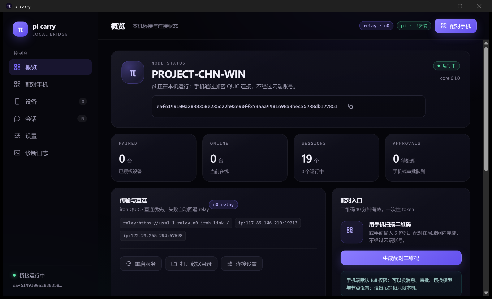
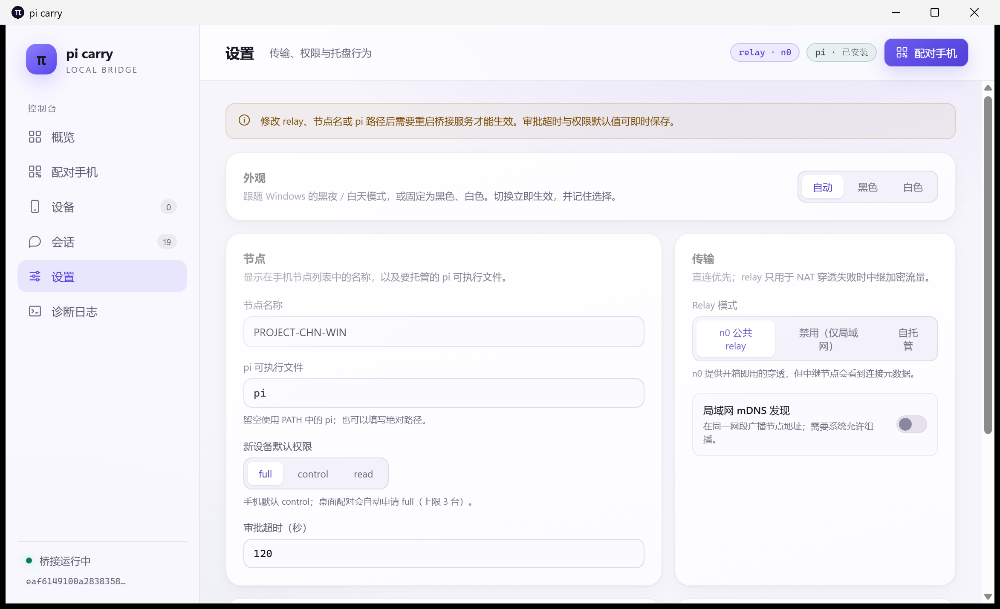
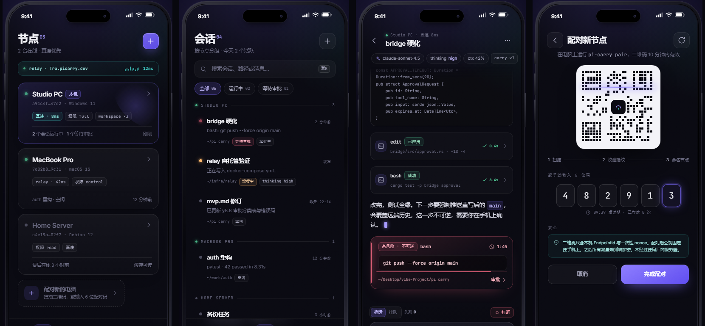

<p align="center">
  
</p>

<h1 align="center">Pi Carry</h1>

<p align="center">
  <a href="README.md">English</a> ·
  <a href="README.zh-CN.md">简体中文</a> ·
  <a href="README.ja.md">日本語</a> ·
  <a href="README.ko.md">한국어</a> ·
  <a href="README.ru.md">Русский</a>
</p>

<p align="center"><strong>把电脑上运行的 pi 变成手机可远程驾驶的编程智能体。会话、审批与模型设置在你的设备之间流转，不经过云端账号。</strong></p>

<p align="center">
  
  
  
  
</p>

<p align="center">
  <a href="LICENSE"></a>
  
  
  
  
</p>

## 界面

### 桌面受控端

| 深色概览 | 浅色设置 |
| :---: | :---: |
|  |  |

桌面端是常驻系统托盘的受控端，负责本机 pi 进程、配对、设备和诊断。概览页展示节点状态、已授权设备、会话数量、待审批数量，以及 relay 和局域网直连地址；设置页可修改节点名、pi 路径、默认设备权限、relay 模式和审批超时，并在自动、黑色、白色三档外观之间切换。桌面端不提供聊天和审批入口，避免在电脑上绕过手机端的审批流程。

### Android 控制端



Android 端是主要控制界面：节点页管理多台电脑并显示直连或 relay 状态；会话页按节点分组，支持搜索和运行状态筛选；对话页显示流式文本、思考过程、工具调用和审批卡片，可发送、插话、排队、打断和附加图片；配对页支持扫码、粘贴配对链接或手动输入 Endpoint ID 与 6 位码。

## 关于 Pi Carry

Pi Carry 是 pi 编程智能体的远程控制层。pi 仍在电脑上运行，继续读写原有的会话文件；Pi Carry 在手机和电脑之间建立加密通道，把手机变成第二块屏幕：查看流式回复、思考过程和工具执行，发送新指令，插话、排队或打断，处理高风险操作审批，切换模型和思考等级。

当前版本 `0.1.3` 的正式验证平台是 **Windows 10/11 x64 + Android 8.0+**。Linux/macOS 保留源码构建路径，但尚未完成托盘、自启、单实例和发布包验证。文档中描述但尚未实现的主要功能列在下方[已知限制](#已知限制)。

它不创建会话副本，也不依赖云端账号。桌面受控端以系统托盘应用或 CLI 运行，通过 pi 的 RPC 与本地会话协作；手机可以保存多个节点，在局域网内直连，必要时经 n0 或自托管 relay 穿透 NAT。工具调用通过 pi 扩展拦截后交给桥接核心仲裁，审批超时默认拒绝，桌面端没有审批入口。它适合在离开电脑时继续跟进长任务，而不是把代码、会话或密钥交给第三方服务。

## 安装

### 系统要求

| 平台 | 要求 |
| --- | --- |
| Windows | Windows 10/11 x64；Microsoft Edge WebView2 Runtime；建议 4GB 以上内存；已验证 |
| Linux | glibc 2.31+；WebKitGTK 4.1；libayatana-appindicator3；librsvg2；仅源码构建，未验证 |
| macOS | macOS 12+；Intel 或 Apple Silicon；仅源码构建，未验证，无公证安装包 |
| Android | Android 8.0（API 26）及以上；arm64-v8a 或 x86_64；约 100MB 可用空间 |
| 运行环境 | 已安装并完成配置的 pi 1.5.2 或更高版本；安装 pi 需要 Node.js 20+ |
| 网络 | 局域网直连可离线使用；跨网段或 4G 需要 n0 公共 relay 或自托管 relay |

Pi Carry 不捆绑 pi、Node.js 或模型凭据。请先确认在终端中可以直接运行 `pi --version`，并已经完成 pi 的模型配置。

### 桌面端

从仓库 Releases 下载 Windows 便携包，解压到任意目录，保持 `pi-carry-desktop.exe` 与 `WebView2Loader.dll` 在同一个文件夹，然后运行 exe。程序默认最小化到系统托盘；首次启动会生成 `~/.pi-carry/config.toml`、`~/.pi-carry/secrets.json` 和本地状态数据库。

如果系统没有 WebView2 Runtime，请先从 Microsoft 官网安装 Evergreen Runtime。Linux 和 macOS 目前请按下文“构建”一节从源码编译。

### Android

从 Releases 下载对应 ABI 的 APK：真机通常使用 `arm64-v8a`，x86_64 模拟器使用另一个包。安装时系统可能要求允许来自浏览器或文件管理器的未知来源应用。

### 首次配对

在桌面端打开“配对手机”，生成二维码或复制 `pi-carry://pair?...` 链接。手机端进入“节点”，点击“配对新的电脑”，扫码或粘贴链接；也可以手动输入桌面端显示的 Endpoint ID 和 6 位码。二维码和 6 位码默认 10 分钟有效，连续 5 次输错会锁定一段时间。

配对成功后，电脑会出现在节点列表中。新设备默认获得 `full` 权限；桌面端设置里的“新设备默认权限”可以把之后的新设备改为 `control` 或 `read`。已配对设备不能单独改权限，只能吊销后重新配对。设备列表中可以随时吊销某台设备；该设备的下一次请求会被拒绝，需要重新配对。

## 数据处理与权限

Pi Carry 不运营账号系统，不收集遥测，不把会话上传到自有服务器。数据只在手机、受控端电脑和用户选择的 relay 之间流动。

### 本地数据

| 位置 | 内容 | 说明 |
| --- | --- | --- |
| `~/.pi/agent/sessions/**/*.jsonl` | pi 的会话历史 | 唯一事实源；Pi Carry 只 attach，不复制、不改写既有历史 |
| `~/.pi-carry/config.toml` | 节点、传输、审批、界面配置 | 明文配置，可手工编辑 |
| `~/.pi-carry/secrets.json` | iroh 端点私钥、可选密码哈希 | Unix 下权限 0600，Windows 继承当前用户目录 ACL；丢失后需重新配对 |
| `~/.pi-carry/state.db` | 设备、journal、审批与审计记录 | SQLite，本地保存 |
| `~/.pi-carry/logs/` | 诊断日志 | 不记录 prompt 正文、配对 token 或私钥 |
| Android SharedPreferences | 节点列表、主题和本地开关 | 应用私有目录；卸载应用时删除 |
| Android 应用私有缓存 | 待发送图片的压缩结果 | 仅保存用户主动选择的图片 |

手机不是会话的第二份长期存储。消息和工具事件通过持久连接实时接收，断线重连后从受控端的 journal 或会话快照补齐；真正长期保存会话的是 pi 自己的 `.jsonl` 文件。

### Android 权限

| 权限 | 用途 | 处理方式 |
| --- | --- | --- |
| `INTERNET`、`ACCESS_NETWORK_STATE` | 建立 iroh QUIC 连接、检测网络变化 | 仅用于与已配对节点通信 |
| `CHANGE_NETWORK_STATE` | 网络切换后重新绑定 iroh 端点 | 不修改用户的网络配置 |
| `CAMERA` | 扫描配对二维码 | 运行时申请；画面仅用于本地识别，不保存、不上传 |
| `POST_NOTIFICATIONS` | 审批提醒和会话完成提醒 | Android 13+ 运行时申请，可拒绝 |
| `FOREGROUND_SERVICE`、`FOREGROUND_SERVICE_CONNECTED_DEVICE` | 保持与电脑的长连接 | 常驻通知可见，可随时停止服务 |
| `RECEIVE_BOOT_COMPLETED` | 开机后启动连接前台服务 | 可在系统设置中禁止自启动；当前版本不会自动恢复节点连接 |
| `WAKE_LOCK` | 预留网络切换/短任务唤醒 | 当前版本声明但未主动持有 |
| `REQUEST_IGNORE_BATTERY_OPTIMIZATIONS` | 用户主动打开电池优化设置 | 只在用户点击时跳转，不静默申请 |

应用不申请通讯录、短信、位置、麦克风或全盘存储权限。发送图片使用系统照片选择器，只读取用户明确选择的图片；图片在手机上压缩为长边 1568、JPEG q85 后发送给已配对的受控端。

### 桌面端权限

桌面端以当前用户身份运行，不需要管理员权限。它读取和写入 pi 的会话目录、`~/.pi-carry` 下的配置、密钥、数据库和日志，并启动本机 `pi --mode rpc` 子进程。启用开机自启时，会在当前用户的注册表启动项中写入一条记录；关闭后删除。桌面端不访问摄像头、麦克风、屏幕内容或键盘输入。

### 删除数据

卸载 Android 应用会删除应用私有数据；吊销设备后，受控端不再接受该设备连接。删除 `~/.pi-carry` 会重置配对、设备和本地 journal，但不会删除 pi 的会话历史。pi 的会话文件需要按 pi 自身的方式管理或备份。

## 已知限制

- **平台**：Windows 已完成构建和托盘验证；Android 只完成构建、签名和 JVM 测试，尚未在真机上验收；Linux/macOS 未验证。
- **Android 后台**：开机广播只启动前台服务，不会自动恢复节点连接；部分厂商的省电策略仍可能终止长连接。
- **会话冲突**：当前只保证同一 bridge 内单写者，不检测本机终端里的 pi 是否正在写同一会话，也不会自动切换只读。
- **网络发现**：未实现 mDNS；二维码携带局域网直连地址。
- **离线发送**：没有本地 outbox，断网时发送会失败。
- **图片**：协议支持 5 张，Android 选择器一次只能选 1 张；图片以 base64 内联，没有 blob 传输。
- **审批**：只读 bash 默认仍询问；“记住此命令”当前不排除 critical 命令，危险命令请逐次审批。
- **未实现入口**：审批延长、会话 fork/rename/entries、通用扩展 UI、设备能力调整、桌面设备重命名、诊断包。
- **交付**：没有 Tauri 安装包、自动更新、代码签名/公证；Android 没有 instrumented tests。

完整缺口与原因见[已知限制](#已知限制)。

## 免责声明

Pi Carry 是独立开源项目，不是 pi、iroh 或 Tauri 的官方项目，与这些项目的维护者没有隶属或背书关系。相关名称和商标归各自所有者。

本项目调用的是能够执行真实命令、修改文件和访问网络的 AI 编程智能体。**AI 输出并非绝对正确，可能包含错误、过时信息、偏见或不安全的建议**；请在使用前自行甄别，**不要盲目执行模型生成的命令或代码**。

审批机制是提示和拦截层，**不是安全沙箱**。即使经过审批，命令仍可能删除文件、覆盖未提交的修改、执行 `git push --force`、安装依赖、读取敏感文件或产生费用。**使用本工具可能造成数据丢失、代码损坏、凭据泄露、服务中断等不可逆后果**。**请务必保留备份**，在可信的代码库和网络环境中使用，并仔细核对命令、工作目录和影响范围。

通过公共 relay 连接时，relay 运营方可能看到连接时间、IP 地址和流量大小等元数据；消息内容由 iroh 端到端加密。需要更严格的隐私边界时，请使用局域网直连或自托管 relay。手机丢失或设备被他人控制时，请立即在受控端吊销该设备。

本软件按 **GNU Affero General Public License v3.0**“原样”提供，不附带任何明示或暗示的担保。**作者和贡献者不对使用本软件造成的任何直接或间接损失、数据丢失、法律或合规问题负责**。请在遵守当地法律、组织安全策略和第三方服务条款的前提下使用。

## 构建

### 通用要求

Rust 1.91 或更高版本、Cargo、Git。Windows 推荐安装 Visual Studio Build Tools 或使用仓库配置的 GNU 工具链；项目在 `x86_64-pc-windows-gnu` 下验证。Linux 需要 WebKitGTK 4.1、libayatana-appindicator3、librsvg2 及常规编译工具；macOS 需要 Xcode Command Line Tools。

```bash
cargo build --release -p pi-carry-cli -p pi-carry-desktop
```

Windows 构建后，`WebView2Loader.dll` 会出现在 `target/release`，分发时必须与 `pi-carry-desktop.exe` 放在同一目录。只使用 CLI 时构建 `-p pi-carry-cli` 即可。

Linux 的 Tauri 依赖可以参考：

```bash
sudo apt install build-essential curl wget file libssl-dev \
  libwebkit2gtk-4.1-dev libayatana-appindicator3-dev librsvg2-dev
```

### Android

需要 JDK 21、Android SDK Platform 36、Build Tools 36.0.0 和 Gradle 8.11.1。设置 `ANDROID_HOME`，或在 `android/local.properties` 中写入 SDK 路径。仓库包含 Gradle Wrapper：

```bash
cd android
./gradlew testDebugUnitTest assembleDebug
```

调试构建的产物位于 `android/app/build/outputs/apk/debug/`。发布包必须使用正式签名构建，不能把 debug APK 当作正式包分发；签名配置和密钥由发布者在本机管理，不进入仓库。

正式签名构建需要一个 Android keystore，并在 `android/keystore.properties` 中提供以下字段（该文件已被 `.gitignore` 排除）：

```properties
storeFile=keystore/release.jks
storePassword=***
keyAlias=pi-carry
keyPassword=***
```

然后执行 `./gradlew assembleRelease`，产物位于 `android/app/build/outputs/apk/release/`。缺少 keystore 时只会得到 unsigned APK，`scripts/package.ps1` 会拒绝打包。

### 测试

```bash
cargo fmt --all -- --check
cargo test -p pi-carry-protocol -p pi-carry-core
./target/debug/pi-carry smoke
./target/debug/pi-carry-desktop --smoke

cd android
./gradlew testDebugUnitTest lintDebug
```

`pi-carry smoke` 使用内置 fake-pi 验证协议、会话、审批和流式事件；`--smoke` 会启动真实桥接并输出节点信息后退出。完整的人工验收还应覆盖真实 pi、真实手机和系统托盘。

### 打包

Windows 便携包可以重新生成：

```powershell
pwsh scripts/package.ps1
```

脚本会收集桌面 exe、`WebView2Loader.dll`、简短说明和正式签名 Android APK，并生成 SHA256 校验和。缺少正式签名 APK 时脚本会直接失败，不会用 debug APK 代替。需要 PowerShell 7，Windows PowerShell 5.1 不保证提供 `Get-FileHash`。

### 关于 vendor 目录

`vendor/iroh` 和 `vendor/iroh-relay` 是为 Windows GNU 链接环境准备的补丁副本：上游库的 `cdylib` 目标会触发导出符号过多的问题，因此将 `crate-type` 收窄为 `lib`。根 `Cargo.toml` 通过 `[patch.crates-io]` 指向这两个目录。升级 iroh 时需要同步更新补丁，或验证上游是否已经修复该问题。

## 目录结构

```text
Pi-Carry/
├── android/                     Android 控制端
│   ├── app/src/main/java/dev/picarry/app/
│   │   ├── data/                模型、节点存储、仓库、图片压缩
│   │   ├── net/                 iroh 连接、帧协议、前台服务、开机广播
│   │   └── ui/                  主题、通用组件、各功能页面
│   ├── gradle/wrapper/          Gradle Wrapper
│   ├── gradlew
│   └── settings.gradle.kts
├── assets/                      Logo 与 README 截图
├── crates/
│   ├── protocol/                carry.v1 帧、JSONL、事件、payload、错误码
│   ├── core/                    配置、SQLite、配对、审批、pi RPC、会话、iroh 服务端
│   ├── cli/                     serve/status/pair/devices/revoke/doctor/smoke
│   ├── desktop/                 Tauri 2 托盘应用
│   ├── fake-pi/                 测试用 pi RPC 模拟器
│   └── e2e-client/              黑盒探针与端到端测试客户端
├── desktop-ui/                  桌面端静态控制台
├── extensions/guard.ts          pi 工具调用拦截扩展
├── packaging/                   桌面发布说明
├── scripts/                     环境、构建、打包、图标脚本
├── vendor/                      iroh / iroh-relay 补丁副本
├── .cargo/config.toml           Windows GNU 链接器配置
├── Cargo.toml                   Rust workspace
├── LICENSE
└── README.md
```

## 项目依赖

| 类别 | 主要依赖 |
| --- | --- |
| 运行时 | pi 1.5.2+；Windows WebView2 Runtime；可选 n0 或自托管 iroh relay |
| 桌面与核心 | Rust 1.91+、iroh 1.3、tokio、rusqlite（bundled SQLite）、serde、argon2、qrcode、if-addrs、ulid |
| 桌面外壳 | Tauri 2、系统 WebView、静态 HTML/CSS/JS |
| Android | Kotlin 2.4.10、Jetpack Compose（BOM 2025.02.00）、Material 3、iroh4k 0.2.0、kotlinx.serialization、ZXing、ExifInterface |
| Android 测试 | JUnit 4、Robolectric、AndroidX Test |
| 构建 | Cargo、JDK 21、Android SDK 36、Gradle 8.11.1、PowerShell 7（打包） |

第三方依赖分别遵循其自身许可证。发布二进制时请同时遵守 pi、iroh、Tauri、iroh4k 等项目的许可与署名要求。

## 贡献

欢迎通过 Issue 反馈问题或提出建议。也可以发送邮件至 [cyfor@foxmail.com](mailto:cyfor@foxmail.com)，或访问[个人主页](https://www.cyfor.cn/%e5%85%b3%e4%ba%8ecyfor/)。

## 许可证

Pi Carry 以 [GNU Affero General Public License v3.0](LICENSE) 发布。若修改后通过网络向他人提供服务，请按 AGPL 的要求提供对应源码。
